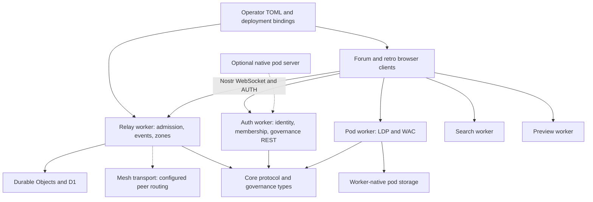
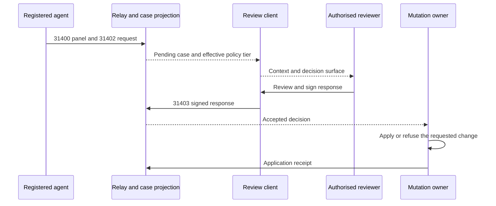

<div align="center">

# nostr-rust-forum

### A Rust community kit for Nostr messaging, access control and agent governance

[Start](#quick-start) · [Architecture](#architecture) · [Governance](#signed-governance) · [Interop](#interoperability-and-deployment-profiles) · [Status](#working-status) · [Setup](SETUP.md)

</div>

**Build a community where people and agents publish signed events under explicit access rules.** The kit supplies forum and retro browser clients, a relay, auth/pod/search/preview workers, shared libraries and operator tools. Branding, zones and deployment values belong in an operator configuration rather than a fork of the protocol implementation.

Use it for a layered community, team discussion, private messaging or a review surface for agent proposals. A signature identifies a key; roles and policy decide what that key may do. It does not by itself prove a human participated or that an approved action happened.

## Quick start

Copy the example configuration and read the setup path before provisioning infrastructure:

```sh
git clone https://github.com/DreamLab-AI/nostr-rust-forum.git
cd nostr-rust-forum
cp forum.example.toml forum.toml
```

[`forum.example.toml`](forum.example.toml) describes the configuration sections. Choose the implemented `forum` deployment profile, then configure hostname, zones, cohorts and the relevant services. The `room` profile is a roadmap option, not a working alternative today.

For source development, install the Rust/WASM toolchain and Trunk, then build the client:

```sh
rustup target add wasm32-unknown-unknown
cargo install trunk
cd crates/nostr-bbs-forum-client
trunk serve
```

A local client still needs configured worker/relay endpoints for account and messaging operations. [SETUP.md](SETUP.md) covers Cloudflare resources, secrets, bindings, migrations, client builds and DNS. The workspace declares Rust 1.85, while individual dependencies/build tools may impose later requirements; use the lockfile and CI toolchain when reproducing a release.

```sh
# From the repository root, with the required native dependencies available:
cargo build --workspace --locked
cargo test --workspace --locked
```

The standalone community is the first deployment path. Cross-repository runtime integration needs additional configuration and acceptance evidence.

## Architecture



Source ownership is divided across the [workspace manifests](Cargo.toml), [architecture guide](docs/architecture.md) and [baseline](docs/BASELINE-architecture.md). The core, configuration, mesh and operator tools are distinct from deployed clients/workers. A package release is not a complete community deployment.

### Zones and identity

Zones group channels by cohort policy. `public`, `locked` and `hidden` visibility control listing and reading; write permissions are configured separately. The relay enforces access, while clients render the corresponding tiles. TOML, worker bindings and injected browser configuration must agree; duplicated projections are a contract to check, not an automatic guarantee of consistency.

Passkeys, extension signers and configured keys offer different custody paths. NIP-42 authenticates a relay connection and NIP-98 binds an HTTP request. DID document helpers and pod integration have their own feature/licence boundaries. A portable public key does not grant cross-service permissions.

<details>
<summary><strong>Community capabilities and operator responsibilities</strong></summary>

- Forum topics, nested replies, chat, profiles, direct messages and a retro client share the event substrate.
- Zones and cohorts separate openly readable areas from restricted groups. Encryption and key distribution add a separate boundary to relay access control.
- Calendar projection can return full event detail, free/busy information or omission for a viewer. A projected/redacted representation is not the original signed event.
- Pod routes expose a Worker-compatible Solid tier. Native git-backed capabilities require the separate native pod integration; the Worker cannot run a native git process.
- Search uses the configured worker/embedding/storage stack. Preview fetching has its own network and SSRF policy.
- Optional poker, sidestr and governance tools need their corresponding services and configuration; compiling the workspace does not activate every feature.

Read [architecture](docs/architecture.md), [consumer surfaces](docs/consumer-surface-map.md), [security policy](SECURITY.md) and the operator setup before enabling a surface.

</details>

## Signed governance

An agent publishes a panel and request. A permitted reviewer inspects the case and signs a response. The mutation owner later reports whether the approved action was applied. These are distinct stages; a relay acknowledgement is not an application receipt.



| Kind | Name | Publisher | Purpose |
|------|------|-----------|---------|
| 31400 | PanelDefinition | Agent | Declare a control panel (schema, fields, actions) |
| 31401 | PanelState | Agent | Publish a current panel data snapshot |
| 31402 | ActionRequest | Agent | Request a human decision |
| 31403 | ActionResponse | Human | The signed decision (admin key, or a reviewer for a case delegated to them) |
| 31404 | PanelUpdate | Agent | Incremental state diff |
| 31405 | PanelRetired | Agent | Retire a control panel |

The operator's task-property declaration sets the escalation boundary; a request can tighten it. Role and delegation policy govern admission of a response. High/critical cases require the configured human-response path. A cryptographic event alone cannot establish who physically controlled a signing key.

See [ADR-2011](docs/adr/ADR-2011-operator-task-properties-set-the-escalation-boundary.md) and [governance flows](docs/diagrams/auth-governance-flows.md). The documented estate consumer is VisionClaw's ontology-review workflow; universal production use is not established. Application receipts belong to the system that performs the mutation.

## Interoperability and deployment profiles

**Main and the upgrade branch differ.** The main branch contains the interop design documents; the implementation described for NIP-17 and NIP-171 below is on [`feat/upgrade-phase-0-1`](https://github.com/DreamLab-AI/nostr-rust-forum/tree/feat/upgrade-phase-0-1), not merged into main. Cloning the quick-start command above does not include that implementation.

Standard event formats do not guarantee that any client can join every restricted community. Admission, channel dialect, encryption, key delivery and relay discovery must agree.

| Layer | Source position | Activation boundary |
|---|---|---|
| NIP-42 relay admission | Implemented; example worker selects `AUTH_MODE=nip42` | Configure the relay's own URL/aliases and membership policy |
| Mesh transport | Concrete transport and delegation validation exist | Peer configuration and a live cross-node run are separate evidence |
| NIP-17 overlay | Implemented on the upgrade branch under [ADR-2027](docs/adr/ADR-2027-nip17-overlay-for-nostr-chat-interop.md) | `RECIPIENT_KEYS_ENABLED` is off by default |
| NIP-171 zone key plane | Implemented on the upgrade branch behind a flag; design remains proposed in [ADR-2028](docs/adr/ADR-2028-zones-adopt-nip171-key-plane.md) | `ZONE_GROUPS_ENABLED` is off; pre-activation blockers remain |
| `room` profile | Configuration and roadmap described by [ADR-2029](docs/adr/ADR-2029-room-profile-deployment-type.md) | Channel-dialect implementation is not built |

The implemented `forum` profile uses the existing channel dialect. Consult [deployment profiles](docs/deployment-profiles.md) and [interop assessments](docs/interop/) for the transition and recovery constraints. A proposed interoperability layer is not a claim of a completed acceptance session with another app.

## Working status

**Publication checked 21 October 2026 against main `7096903` and the upgrade branch.** Main's core manifest declares **1.0.0-beta.18**. The reviewed upgrade worktree at `c1657fc` declares **1.0.0-beta.20**; its public branch was at `053f734` when this page was published. Other crates and consumers have independent versions/pins. The later local migration-ordering and time-bounded NIP-26 fixes remain unpublished work, not main-branch guarantees.

This documentation update does not merge the upgrade branch or activate its flags. The review inspected source and existing evidence; it did not deploy a fresh D1 database, run the full workspace suite or verify a live federation session. Current uncommitted zone-crypto/example-config changes were preserved. The [decision ledger](docs/adr/README.md) records decisions, implementation and activation on independent axes.

## Where it sits in VisionFlow

[VisionFlow](https://github.com/DreamLab-AI/VisionFlow) owns the estate architecture. This kit owns communication and review surfaces; [DreamLab's website](https://github.com/DreamLab-AI/dreamlab-ai-website) consumes selected revisions and supplies its operator overlay. [Agentbox](https://github.com/DreamLab-AI/agentbox) runs agents and product-specific bridges; [VisionClaw](https://github.com/DreamLab-AI/VisionClaw) owns knowledge application and mutation paths. [solid-pod-rs](https://github.com/DreamLab-AI/solid-pod-rs) supplies foundation functionality with tier-specific consumption.

An event signed here does not establish every other service's state. The estate's compatibility and acceptance records describe those seams.

## Documentation, credit and licence

[Setup](SETUP.md) · [Architecture](docs/architecture.md) · [Decision ledger](docs/adr/README.md) · [Changelog](CHANGELOG.md) · [Contributing](CONTRIBUTING.md) · [Security](SECURITY.md)

Application/worker code follows **AGPL-3.0-only**. `nostr-bbs-core` declares **MIT OR Apache-2.0** from its beta.18 relicense; its default-off `did` feature adds the Solid dependency and changes the combined dependency obligations. Inspect the actual feature graph and individual manifests rather than applying a blanket licence to every build. [LICENSE](LICENSE), [core documentation](crates/nostr-bbs-core/README.md) and [MAINTAINERS.md](MAINTAINERS.md) carry terms and attribution, including the Solid/JSS lineage of Melvin Carvalho's work.
