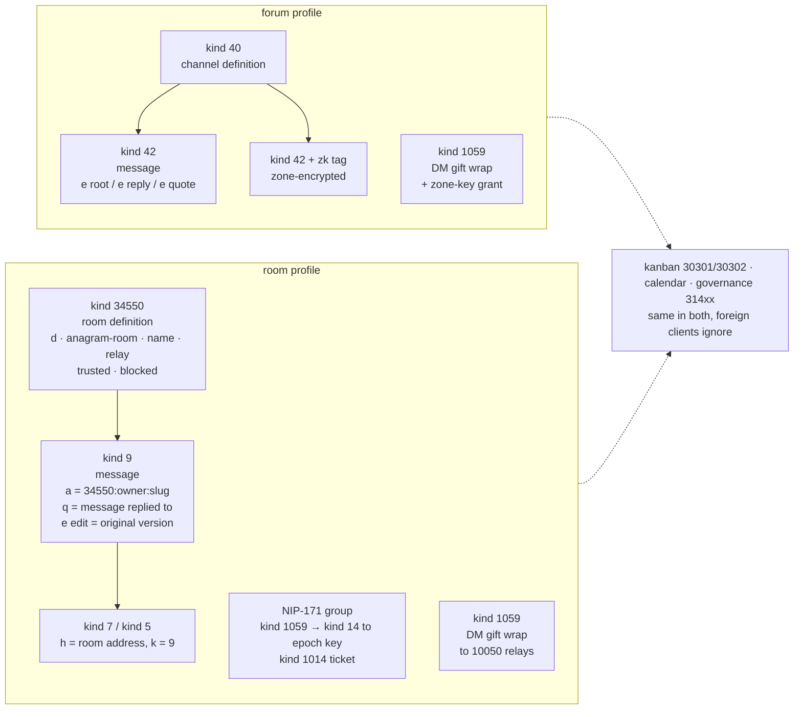
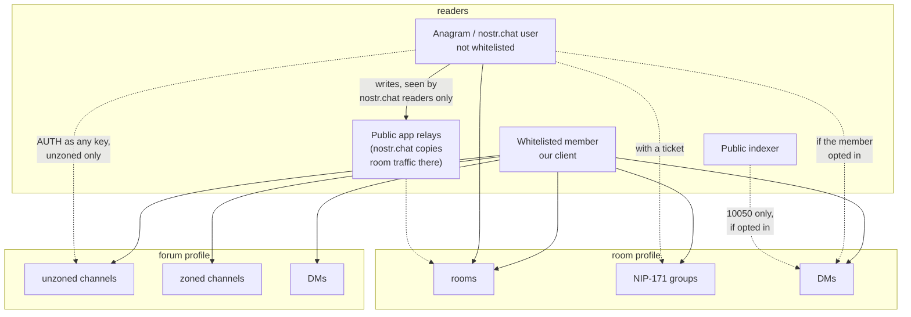
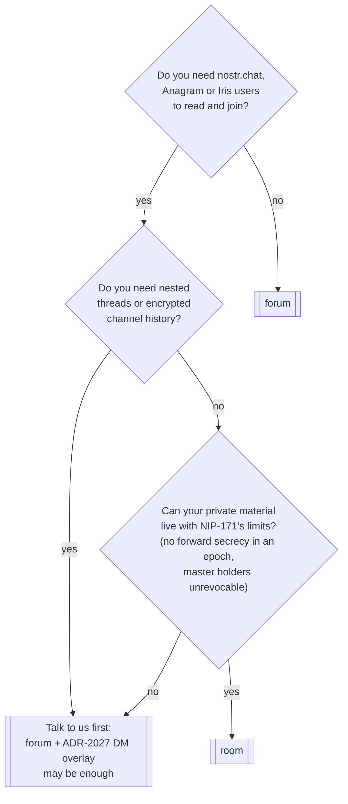

# Deployment profiles

> Status: proposed under ADR-2029. Nothing here is implemented yet. This page is written first
> so that the decision can be judged by what an operator would read.

The kit builds one of two boards from the same source tree. The choice is made once, at
deployment, with one key in `forum.toml`:

```toml
[deployment]
profile = "forum"   # or "room"
```

| | `forum` (default) | `room` |
|---|---|---|
| Who it is for | A members-only community that wants threaded discussion, encrypted zones and relay-side moderation. The DreamLab board. | A community that wants to be read and joined from nostr.chat, Anagram and Iris, and accepts a flatter, more public shape. |
| Public channels | NIP-28: kind 40 definition, kind 42 messages, nested threads with root, reply and quote markers | Anagram rooms: kind 34550 definition signed by the owner, kind 9 messages, one level of `q` replies |
| Who can read channels | Members, after NIP-42 AUTH, and anyone for channels not in a zone | Anyone with the relay URL. Kind 9 is not a protected kind, and nostr.chat also copies room traffic to five public app relays. |
| Who can write | Whitelisted members | To our replica, whitelisted members. To the room as nostr.chat sees it, anyone: a non-whitelisted key posts to the public app relays and nostr.chat readers see it while ours do not. `blocked` is hidden on read by both clients; `trusted` only unlocks links and media in nostr.chat. |
| Private spaces | Encrypted zones, ADR-2016: `zk`-tagged kind 42, relay zone gate, sealed history | NIP-171 epoch groups, ADR-2028: gift-wrapped kind 14 to the epoch key, tickets, recovery master. Readable natively by Anagram. |
| Direct messages | NIP-17 gift wraps on our relay | NIP-17 with the ADR-2027 overlay: recipient's relay list resolved, member lists published to the indexers behind an opt-in |
| Moderation on the wire | Relay ban gate, trust levels, admin hide, zone cohorts | Relay ban gate and trust counters apply to kinds 9 and 34550 on our relay. An admin deletion removes the message from our relay for everyone reading it, but it survives on the public app relays. Only an author's own deletion travels everywhere. |
| Threads | Nested | Flat chat with inline quotes, as nostr.chat renders it. `q` names the message replied to. |
| Edits | Not on the wire | Anagram edit convention: new event with the original `created_at`, `e` tag marked `edit`. Our relay admits these past-dated edits in `room`. |
| Kanban, calendar, governance | Ours, unchanged | Ours, unchanged, invisible to foreign clients |
| Forward secrecy in private spaces | None within an epoch | None within an epoch; master holders cannot be revoked by rotation |
| Can it be switched later | No | No. The channel kind is inside every signed event id. |

## 1. Wire shape per profile



## 2. Who can read what



In both profiles the relay still learns the authenticated key of every reader. In `room` the
room list is public to anyone who connects, and our relay is one replica of each room: as
nostr.chat sees it, a room is open-write and world-read across the relays in its definition plus
the public app relays. Our whitelist decides who writes to our replica, nothing more.

## 3. Choosing



## What the profile projects to

| Surface | `forum` | `room` |
|---|---|---|
| `forum.toml` | `[deployment] profile = "forum"` | `[deployment] profile = "room"` |
| Relay wrangler var, projected by `nostr-bbs-config` | `CHANNEL_DIALECT = "nip28"` | `CHANNEL_DIALECT = "anagram"` |
| Relay NIP-11 `nostr_bbs` block | `"dialect": "nip28"` | `"dialect": "anagram"` |
| Client | one build, both dialects compiled; reads the dialect from the relay's NIP-11 at runtime, `window.__ENV__` as offline fallback | same |
| Relay database | pins the dialect in a settings row on first write; refuses to start under the other | same |
| Relay info document | advertises neither NIP-29 nor NIP-17 until each is really implemented | same |

The relay is the single authority. There is no client build flag to get wrong. The config
validator only parses `forum.toml`; it cannot see the database and does not claim to.

## What `room` does not give you

- Threads. Anagram rooms are a flat chat with inline quotes and our client renders them that way
  in this profile.
- Encrypted channel history. Private material is NIP-171 groups, with the limits above.
- A members-only room. nostr.chat authenticates with any key and copies members' own messages
  to public relays, so no relay-side read rule can close a room.
- Relay-enforced trust in foreign clients. `trusted` and `blocked` are tags in the room
  definition that other clients apply when rendering; our whitelist decides who writes to our
  replica only.
- A later switch to `forum`. Plan the profile before the first post.

## Related

- ADR-2029, the decision. ADR-2027 (DM overlay) and ADR-2028 (NIP-171 zones) are prerequisites of
  `room`.
- `docs/interop/nostr-chat-interop-assessment-2026-10-20.md` for the wire comparison that led
  here, and `docs/diagrams/relay-event-admission.md` for the admission path both profiles share.
