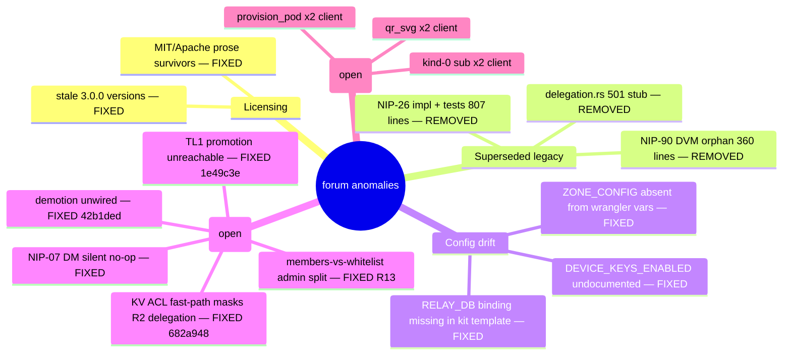

# Anomaly Register — nostr-rust-forum

> Re-verified against `origin/main` `3c48e2656d7cabefa894a59b827f5f0d3a8b32b7` (v1.0.0-beta.21-rc.2) on 2026-11-22 after the PRs #89 to #94. Entries were checked against the code at that revision; resolved ones cite the fixing code. Next free open id: O27. Where the same item is also recorded in `docs/security/known-findings.md` the KF id is given as plain text.

Ecosystem audit 2026-06-11 (diagram-driven, ruflo mesh: 4 sonnet cartographers + 2 opus auditors + 2 opus fixers, Fable queen). Companion diagrams in this directory are the ground-truth maps this register ranks:

- [relay-event-admission.md](relay-event-admission.md)
- [auth-governance-flows.md](auth-governance-flows.md)
- [pod-acl-and-identity.md](pod-acl-and-identity.md)
- [client-onboarding-and-messaging.md](client-onboarding-and-messaging.md)

## Resolved in this sweep (commit refs in CHANGELOG)

| ID | Finding | Resolution |
|----|---------|------------|
| R1 | README/CONTRIBUTING/3 crate READMEs claimed MIT/Apache on the AGPL-3.0-only codebase (404 LICENSE links) | All licence prose → AGPL-3.0-only |
| R2 | Version drift: README `v3.0.0-rc11`, SECURITY rc7/rc6 table, NIP-11 served `"3.0.0"` | All → 1.0.0-beta.2; nip11.rs now `env!("CARGO_PKG_VERSION")` |
| R3 | NIP-17 over-advertised (README list + coverage table) — only NIP-59 gift-wrap transport exists | List corrected; row re-labelled transport-only |
| R4 | NIP-26 implementation + 435-line test suite + auth-worker `/api/delegation/verify` 501 stub — superseded by ADR-099 device keys; CHANGELOG even *recommended* NIP-26 | Deleted (~860 lines); CHANGELOG corrected to point at ADR-099. **API-breaking for next publish → 1.0.0-beta.3** |
| R5 | NIP-90 DVM module exported with zero consumers | Deleted (~360 lines) |
| R6 | `DEVICE_KEYS_ENABLED`, `ZONE_CONFIG`, pod/auth vars absent from SETUP + wrangler `[vars]`; `RELAY_DB` D1 binding missing from kit auth-worker wrangler.toml (downstream deploys patch it — template drift only) | SETUP + both wrangler.toml templates corrected |
| R7 | ~15 ad-hoc `format!("did:nostr:{...}")` sites bypassing exported `did_nostr_uri` (itself orphaned) | Routed through the helper |
| R8 | auth-worker dual `cors_headers()` — `http.rs` fallback-granted `https://example.com` on misconfigured deploys | Consolidated fail-closed |
| R9 | architecture.md missing NIP-56/59/65/90 rows, rate-limit crate, ADR-098/099 coverage; ADR-099 status stale | Added/updated |
| R10 | O1: `posts_read` never incremented → TL0→TL1 promotion unreachable for readers; `check_demotion` unwired | Reads tallied post-zone-filter, batched `increment_posts_read_by` + `check_promotion` at EOSE (commit 1e49c3e); demotion wired via 5-min cron `sweep_inactive_demotions` with admin/TL3 exemption and EOSE `last_active_at` stamping (commit 42b1ded, ADR-102) |
| R11 | O3: KV `acl:{pubkey}` fast-path unconditionally shadowed R2 sidecars → delegation grants unreachable | R2 sidecars now authoritative; KV consulted only as miss-fallback; pure `resolve_effective_acl` + 4 regression tests (commit 682a948) |
| R12 | O5: kind-40 deletion locked out the creator | Creator persisted in `channel_creators` (`storage.rs:232-246`, `lib.rs:735-739`, `nip_handlers.rs:3701-3724`) |
| R13 | O4: `members` vs `whitelist` admin split | Relay admin = static `ADMIN_PUBKEYS` then `whitelist.is_admin` (`auth.rs:181-202`) |

## Open — behavioural (need decisions/tests, not auto-fixed)

| ID | Sev | Where | Finding |
|----|-----|-------|---------|
| O1 | ~~HIGH~~ **RESOLVED** | `relay-worker` (see R10) | ~~`increment_posts_read` dead → TL1 promotion unreachable; `check_demotion` unwired~~ — fixed in commits 1e49c3e (EOSE read tallying) and 42b1ded (cron demotion sweep, ADR-102). |
| O2 | HIGH | `relay-worker/src/relay_do/nip_handlers.rs:1329-1341` | NIP-29 group metadata (39000-39002) admitted from admin clients instead of relay-key-signed (acknowledged TODO at `1330-1332`). Spec drift; `nip11.rs:16` does not advertise NIP-29. |
| O3 | ~~MED~~ **RESOLVED** | `pod-worker/src/acl.rs:314` (see R11) | ~~KV fast-path shadows R2 sidecars~~ — fixed in commit 682a948 (R2 authoritative, KV miss-fallback only; resolver now `find_effective_acl`, `acl.rs:314-376`). The residual (auth-worker `provision_pod` dead path) is also closed: it was removed in 5910bd0 and auth-worker `pod.rs` holds only `handle_profile` (`pod.rs:9`). |
| O4 | ~~MED~~ **RESOLVED (R13)** | `relay-worker/src/auth.rs:181-202` | ~~Admin in `members` but not `whitelist`~~ — the relay no longer queries `members`: admin is the static `ADMIN_PUBKEYS` set, then `whitelist.is_admin` (`auth.rs:184-200`). |
| O5 | ~~MED~~ **RESOLVED (R12)** | `relay-worker/src/relay_do/nip_handlers.rs:3701-3724` | ~~Kind-40 deletion destroys the creator lookup~~ — the creator is persisted in `channel_creators` at store time (`storage.rs:232-246`, `lib.rs:735-739`) and read first by `is_channel_creator`. |
| O6 | ~~HIGH~~ **RESOLVED** | `forum-client/src/dm/mod.rs:320-368` | ~~NIP-07 users get a silent no-op DM subscription~~ — DMs are `Signer`-based, so extension users send and receive; an extension without NIP-44 gets a state error (`dm/mod.rs:1253-1264`) and a banner (`pages/dm_list.rs:295-296`, `334-345`). |
| O7 | ~~HIGH~~ **RESOLVED** | `forum-client/src/pages/settings.rs:35` | ~~`NIP05_USERNAME_HOST` hardcoded in settings~~ — settings imports `NIP05_HOST` from `components/onboarding_modal.rs:56-62`, baked from `NOSTR_BBS_NIP05_DOMAIN`; `"example.test"` remains only as the unconfigured-build fallback (`onboarding_modal.rs:61`). |
| O8 | MED | client | Duplications, re-verified: `provision_pod` now has three copies (`signup.rs:170-204`, `settings.rs:2017-2052`, `utils/pod_client.rs:46-78`); `qr_svg` x2 (`recovery_sheet.rs:60-75`, `utils/devices.rs:241-259`); relay URL resolved twice with diverging fallbacks (`relay.rs:1534-1553`, `utils/relay_url.rs:7-15`). The per-page kind-0 subscription no longer auto-closes after 5 s (`settings.rs:457-479`). |
| O9 | ~~LOW~~ **AMENDED** | `nostr-bbs-mesh` crate / relay `mesh.rs` | The relay now implements `MeshTransport` over its own socket (`mesh.rs:1-52`); the ingress guards `is_mesh_peer` and `is_federated_kind_allowed` remain inline env-var checks (`nip_handlers.rs:4702`, `4730`). |
| O10 | LOW | core | `wasm_bridge` NIP-98/schnorr exports with no JS consumers (still holds, `wasm_bridge.rs:88-249`); the pod-worker deferral shims `key_provisioning.rs` and `nip05_endpoint.rs` are **deleted** (c0fd600, `pod-worker/src/lib.rs:37-40`). The `#[ignore]`d upstream-vector CI wiring is not re-checked. |
| O11 | LOW | auth-worker | `KV` and `SESSIONS` still share one physical namespace but the collision risk is mitigated (rate-limit keys are `rl:`-prefixed, `nostr-bbs-rate-limit/src/lib.rs:45`; admin cache no longer an authority, `admins.rs:47-97`); `broker_decisions` now has a read endpoint (`governance_api.rs:619-661`, route `lib.rs:556`). `/api/native-pod/provision` caller: `(unverified at 3c48e26)`. |

## Opened by the 2026-11-22 sweep (PRs #89 to #94)

Each was verified against the code at `3c48e26`; written records in `docs/security/known-findings.md` are named in the last column (plain text).

| ID | Sev | Where | Finding | KF |
|----|-----|-------|---------|----|
| O12 | MED | `relay-worker/src/lib.rs:793-823`, `nip_handlers.rs:42` | The member kind-5 gate answers up to 2,000 targets with one `json_each` statement; every test of it runs on in-memory rusqlite (`nip_handlers.rs:7698-7707`, `7756-7772`), never on Cloudflare D1. (relay diagram 9) | KF-21 |
| O13 | MED | `nip_handlers.rs:3045-3056`, `3533-3545`; `lib.rs:915-925` | A no-row target is accepted on a `deleted_events` `(id, signer)` row. `process_deletion` writes such a row for any well-formed id (moderators are not gated) and pre-gate claims exist, so a signer can re-name an id never stored here; clients honour every deleter for an ordinary post (`forum-client/src/stores/tombstones.rs:5-8`, `118-120`). New member claims are refused (`nip_handlers.rs:3055-3056`). | KF-17 |
| O14 | LOW | `nip_handlers.rs:3351-3355`; `filter.rs:375-388`; `cron.rs:411-440` | A kind-5 with no `e` or `a` target, and one with an `expiration` tag, are accepted; an expiring kind-5 is later deleted by the retention sweep, which the client's deletion sync names as an accepted residue (`deletion_sync.rs:35-39`). | KF-20 |
| O15 | MED | `whitelist.rs:524-525`, `lib.rs:362`, `lib.rs:953-964` | No admin route removes a tombstone; only `reset-db` wipes them all. | KF-14 |
| O16 | MED | `moderation.rs:142`, `201`, `211`; `nip_handlers.rs:4765` | `GET /api/reports` lists `reportedPubkey` as the reporter's `p` tag claimed it; the stored author is read only by the resolve route (`moderation.rs:335-346`). | KF-15 |
| O17 | MED | `user_admin.rs:218-241` | The user purge tombstones and deletes by `pubkey` only: events signed by the user's device keys and gift wraps (ephemeral authors) are not covered. | KF-16 |
| O18 | LOW | `nip_handlers.rs:3437-3449`, `3396-3399` | The sealed-envelope delete checks the envelope author against current admin status, not a migrator list. | KF-18 |
| O19 | MED | `nip_handlers.rs:2952-2962`, `3054`; `admin_events.rs:279-283` | A member cannot delete their own migrated (sealed) post: the gate refuses it by design and the code says original authors are not recorded. The purge does write `(id, original author)` tombstones as a side effect, but the classifier reads the sealed flag first so they are unused. | KF-19 |
| O20 | LOW | `nip_handlers.rs:1862` vs `1929` | The subscription-cap check precedes awaits (`1907`, `1908`) and the insert follows them, so concurrent REQs with distinct ids can exceed the cap. | KF-22 |
| O21 | MED | `forum-client/src/pages/thread.rs:485-506`, `637-655`; `utils/lookup.rs:91-102`; `zone_crypto/store.rs:407-412` | In an encrypted zone a cold deep link can show "Topic Not Found" between the authenticated answer and zone-key arrival (seen live 2026-11-22, about 12 s to 29 s, then self-corrects; fix branch in progress). Mechanism read from code, not reproduced. | KF-23 |
| O22 | MED | `relay.rs:769-789`, `815-826`, `511-517` | A post made while the socket is closed goes to `pending_messages` and is flushed before AUTH on reopen. | KF-24 |
| O23 | LOW | `forum-client/src/stores/deletion_sync.rs:30-34`, `424-439` | Deletion paging has no resume cursor when it gives up. | KF-25 |
| O24 | MED | `zone_crypto/key_owner.rs:13-19`; `components/bookmarks_modal.rs:1-15` | Legacy key rows and pre-#92 bookmarks stay visible to every account on a browser. | KF-26 |
| O25 | MED | `stores/tombstones.rs:12-18`; `relay-worker/src/whitelist.rs:135-142`, `180`; `relay-worker/src/auth.rs:181-191` | The client cannot identify TL3 moderators, and `check-whitelist` `isAdmin` omits static `ADMIN_PUBKEYS` admins that the relay itself honours. | KF-27 |
| O26 | LOW | `pages/pod_browser.rs:1045-1061`, `1172-1181` | The Pod Browser's mesh card prints the raw probe error under "Details". Whether it is a stack trace depends on the failing call and was not established. | KF-28 |

## Verdict

Workers' SQL parameterisation, request-path unwraps, NIP-98 consolidation (one authoritative core impl), device-key gating coverage, and licence headers in source all verified **clean**. O1 and O3 were closed by the 2026-06-11 fix wave (R10/R11). As of 2026-11-22 O3 to O7 are closed and the NIP-09 deletion work (#89 to #94) is recorded, with its own open items, as O12 to O20. The remaining debt is concentrated in O2, O8 and O12 to O26: behavioural gaps best attacked with failing repro tests (diagram-driven diagnosis phase 3) rather than doc edits.

## Pending corpus entry — room-dialect sequence (ADR-2029)

When ADR-2029 lands, this corpus gains `room-dialect-channels.md`: the kind 34550 definition
publish, kind 9 post and `q` reply, edit by the Anagram convention, kind 7/5 with `h` and `k`,
and the relay's dialect-selected ban gate and trust counters, each cited to the lines that
implement them. Until then `docs/deployment-profiles.md` holds the three design-level
diagrams; they are not citation-verified and must not be copied into this corpus as is.
