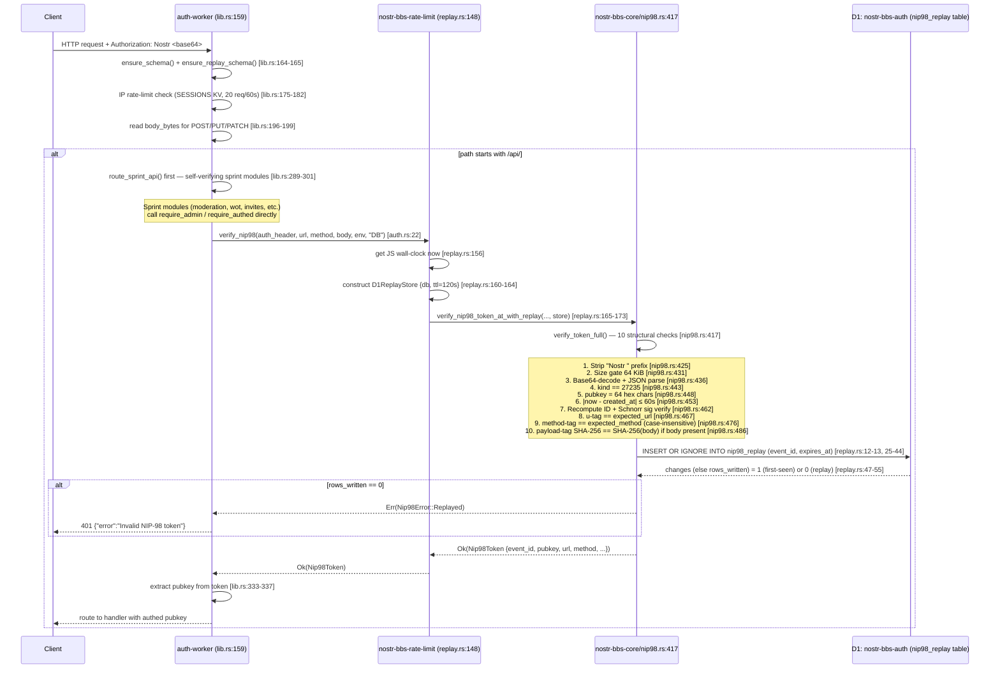
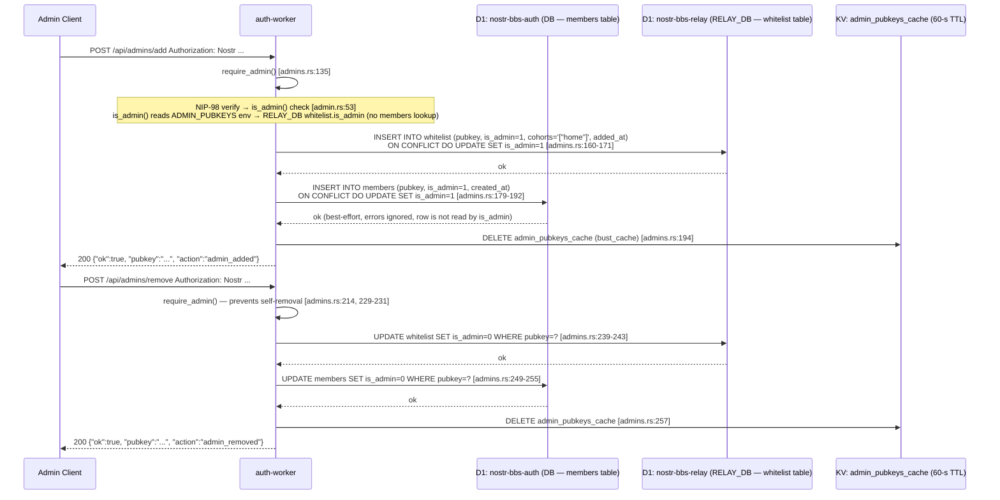
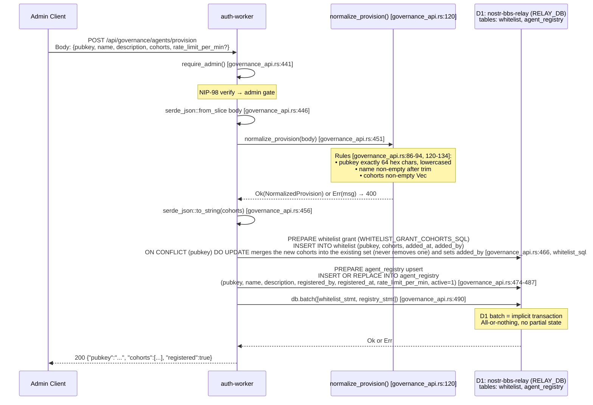
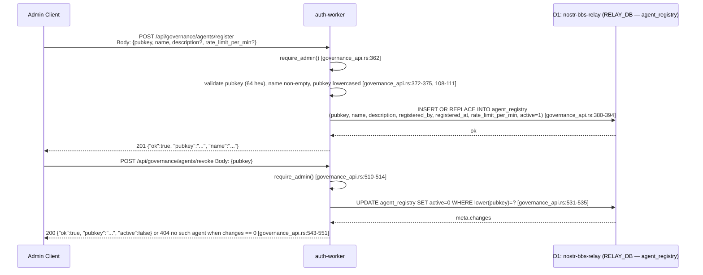
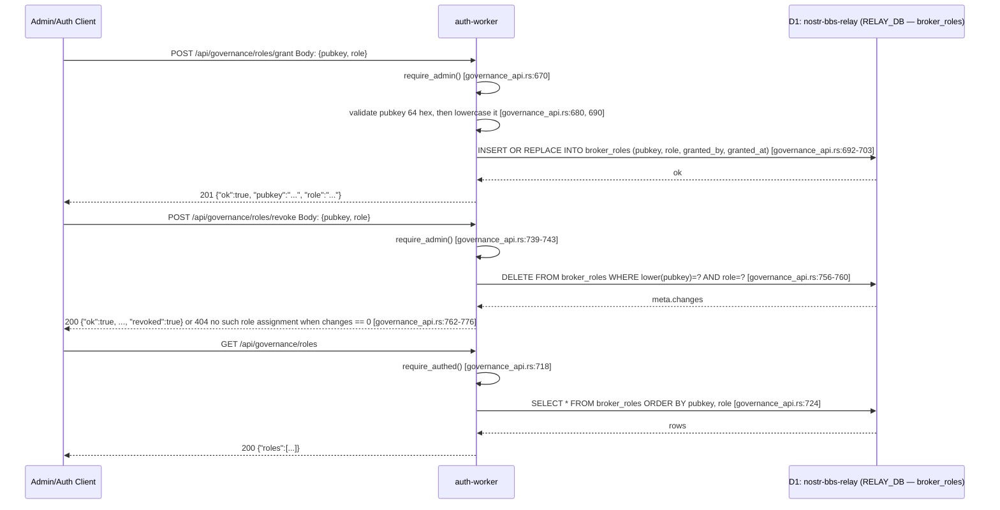
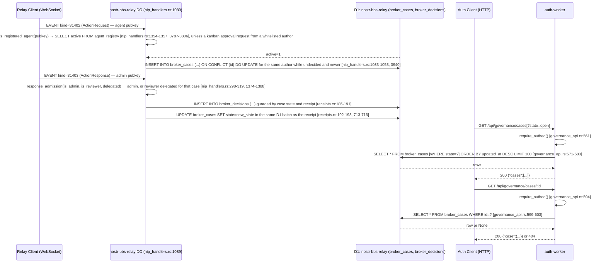
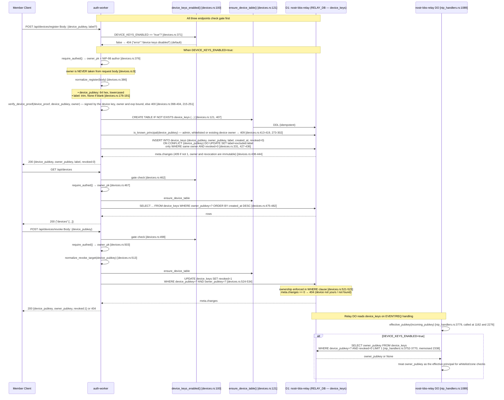

# Auth-Worker Flows: Sequence Diagrams

Generated from source code — not from documentation. All file:line references point at
the Rust source under `crates/nostr-bbs-auth-worker/`.
Re-verified against `origin/main` `3c48e2656d7cabefa894a59b827f5f0d3a8b32b7` (v1.0.0-beta.21-rc.2, 2026-11-22): every citation below was
re-derived from its symbol at that revision.

---

## 1. NIP-98 Request Verification Path

Every `/api/*` route (and the `POST /api/native-pod/provision` out-of-band handler)
passes through this path before any business logic executes.

Sources:
- `lib.rs:145-156`, `lib.rs:159-219` — outer `fetch` + `handle_request`
- `lib.rs:226-351` — `route()` (+ `route_sprint_api()` at `lib.rs:357`)
- `admin.rs:26-34` — `verify()` (thin wrapper)
- `auth.rs:15-31` — `verify_nip98_replay()` (thin wrapper selecting `REPLAY_DB = "DB"`)
- `crates/nostr-bbs-rate-limit/src/replay.rs:148-174` — `verify_nip98()` (actual D1 path)
- `crates/nostr-bbs-core/src/nip98.rs:417-513` — `verify_token_full()` (all structural checks)
- `crates/nostr-bbs-core/src/nip98.rs:564-594` — `verify_nip98_with_replay()` (replay layer)

### Author extraction and authorisation

`Nip98Token.pubkey` is the **recomputed-and-verified** signer pubkey — never trusted
from the client body. Two gate levels consume it:

- `require_authed()` (`admin.rs:125-147`): any valid NIP-98 token; returns `pubkey`.
- `require_admin()` (`admin.rs:92-120`): additionally calls `is_admin(pubkey, env)` (`admin.rs:53-86`),
  which checks two sources in order: `ADMIN_PUBKEYS` env var → `RELAY_DB whitelist.is_admin`.
  The auth-side `members` table is **no longer consulted** (`admin.rs:4-5`, `admin.rs:71-83`): legacy member
  rows never re-grant authority after demotion. The relay's own `is_admin` resolves the same two sources
  (`crates/nostr-bbs-relay-worker/src/auth.rs:181`, `auth.rs:208`).

---

## 2. Governance Flows

### 2a. Whitelist Add / Remove

These operate on `RELAY_DB` (the relay's `nostr-bbs-relay` D1, bound as `RELAY_DB` in
the auth-worker). The binding is now declared in `wrangler.toml` with a placeholder
`database_id` that deployments must override with the relay worker's actual D1 id
(Finding 1, resolved — anomaly register R6).

Sources: `admins.rs:128-264`, `admin.rs:53-120`

### 2b. Agent Provisioning — POST /api/governance/agents/provision (ADR-097)

Atomic D1 batch writing both `whitelist` and `agent_registry` in one implicit D1
transaction. Both tables live in `nostr-bbs-relay` (accessed via `RELAY_DB`).

Sources: `governance_api.rs:405-501`

### 2c. Agent Register / Revoke

### 2d. Broker Roles — Grant / Revoke / List

### 2e. Broker Cases — List / Get (read-only from auth-worker)

Broker cases are **written by the relay worker's Durable Object** (kind-31402
ActionRequests projected by `project_action_request`, `nip_handlers.rs:3901-3982`, whose upsert
is `CASE_UPSERT_SQL`, `nip_handlers.rs:1033-1053`; kind-31403 decisions projected by
`project_action_response`, `nip_handlers.rs:4110-4306`, through the receipts batch,
`receipts.rs:672-716`; kind-31400 PanelDefinitions are stored as events but NOT projected to
`broker_cases`, only consulted for panel tags, `nip_handlers.rs:3833`; the relay cron also
updates case state, `cron.rs:844`) and **read by the auth-worker** via the same `RELAY_DB`
binding.

---

## 3. Device-Key Registry Lifecycle (ADR-099)

All three handlers are gated by `DEVICE_KEYS_ENABLED == "true"` (exact string,
default off). The `device_keys` table lives in `RELAY_DB` (nostr-bbs-relay D1)
so the relay DO can read it without a cross-worker call. The relay does that on EVENT write-gating and REQ/COUNT read-scope resolution (`nip_handlers.rs:1161-1162`, `2276`), not in `handle_auth` (`nip_handlers.rs:2124`).

Sources: `devices.rs:1-550`

---

## 4. Findings

Each finding has: severity (HIGH/MEDIUM/LOW/INFO), file:line, description, and
classification.

---

**Finding 1 — RESOLVED (anomaly register R6)**
`crates/nostr-bbs-auth-worker/wrangler.toml`

~~`governance_api.rs` and `devices.rs` both call `env.d1("RELAY_DB")` at runtime but
no `RELAY_DB` binding appeared in `wrangler.toml`.~~ The kit template now declares a
`[[d1_databases]]` stanza for `RELAY_DB` (`database_name = "nostr-bbs-relay"`) with an
explicit placeholder `database_id` of all-zeros (`wrangler.toml:14-20`) and a comment instructing deployments
to point it at the relay worker's actual D1. Downstream deploys override it; a deploy
that forgets still fails per-request with 500s on `/api/governance/*` and
`/api/devices/*`, but the template drift is fixed.

---

**Finding 2 — RESOLVED (anomaly register R8)**
`crates/nostr-bbs-auth-worker/src/http.rs:19-43`

~~Two `cors_headers()` implementations existed; the `http.rs` version fallback-filled
`"https://example.com"`.~~ Consolidated: `http.rs::cors_headers()` is now the single
canonical builder and is fail-closed — when `EXPECTED_ORIGIN` is unset or empty it
emits **no** `Access-Control-Allow-Origin` header. `lib.rs` imports it
(`use crate::http::cors_headers`, `lib.rs:38`); there is no duplicate definition.

---

**Finding 3 — RESOLVED (anomaly register R4)**
~~`crates/nostr-bbs-auth-worker/src/delegation.rs`~~ (file removed)

~~`POST /api/delegation/verify` 501 stub with no consumer.~~ The NIP-26 delegation
implementation, its test suite, and the auth-worker 501 stub were deleted (~860
lines) as superseded by ADR-099 device keys. No `delegation` route or module remains
in the auth-worker.

---

**Finding 4 — RESOLVED (mitigated by disjoint key prefixes)**
`crates/nostr-bbs-auth-worker/wrangler.toml:26-28`, `wrangler.toml:42-44` — `SESSIONS` and `KV` bindings

The `KV` namespace binding (`id = 901345296c2848788066686aa67d5909`) still resolves to the
same physical KV namespace as `SESSIONS` (same id), and `admins.rs:54` / `admins.rs:101`
use `env.kv("KV")` for the `admin_pubkeys_cache` key. ~~A key collision (e.g. if an IP
address coincidentally matches `admin_pubkeys_cache`) would corrupt the admin cache or
inflate rate-limit counters.~~ The keyspaces are now disjoint by construction: the rate
limiter only writes `rl:{ip}:{bucket}` keys (`crates/nostr-bbs-rate-limit/src/lib.rs:45`),
the `wrangler.toml:22-25` note records the sharing, and `admins.rs:343-349` unit-tests that
`ADMIN_CACHE_KEY` never starts with `rl:`. The cache is also no longer an authority:
`get_admin_pubkeys` re-queries D1 on every call and the KV write is compatibility-only
(`admins.rs:47-97`).

---

**Finding 5 — RESOLVED (COM-17 / F5)**
`crates/nostr-bbs-auth-worker/src/governance_api.rs:27-33`

The module doc comment states "broker_decisions" lives in `RELAY_DB`. ~~`broker_decisions`
(the append-only audit trail of individual decisions) has **no read endpoint** in the
auth-worker; there is no `GET /api/governance/decisions` or equivalent.~~ The read
endpoint now exists: `handle_list_decisions` (`governance_api.rs:619-661`, doc comment
`governance_api.rs:611-618`) behind a `require_authed` gate, routed at `lib.rs:556`,
paged by `?limit=` / `?offset=` with an optional `?case_id=` filter. The relay writes
`broker_decisions` through the receipts batch (`relay_do/receipts.rs:185-191`).

---

**Finding 6 — RESOLVED (shared validator)**
`crates/nostr-bbs-auth-worker/src/governance_api.rs:86-94`

`handle_register_agent` performed pubkey/name validation inline using copied if-blocks,
while `handle_provision_agent` called the extracted `normalize_provision()`, so a change
to validation rules would need applying in two places. Both paths now share
`validate_agent_fields` (`governance_api.rs:86-94`): `handle_register_agent` calls it via
`canonical_agent_pubkey` (`governance_api.rs:108-111`, call at `governance_api.rs:372`)
and `normalize_provision` (`governance_api.rs:120-134`, call at `governance_api.rs:451`)
calls it directly. The unit tests sit in `mod tests` at `governance_api.rs:788`.

---

**Finding 7 — LOW | ok (cross-worker D1 sharing — explicit note)**
`crates/nostr-bbs-relay-worker/src/relay_do/nip_handlers.rs:3752-3770` (`device_owner`)
reads `device_keys` from `self.env.d1("DB")` (the relay's own D1, `nostr-bbs-relay`,
`nip_handlers.rs:3753`), memoised per DO by `cached_device_owner` (`nip_handlers.rs:2338`).
`crates/nostr-bbs-auth-worker/src/devices.rs:87-89` (`relay_db`) writes `device_keys` via `env.d1("RELAY_DB")`
(which is the same physical D1 when the binding is correctly declared, see Finding 1).
This cross-worker D1 sharing is **intentional** and documented in `devices.rs:23-31` and
`governance_api.rs:27-30`. The relay reads; the auth-worker writes. There is no
cross-worker D1 transaction; both ends are designed to tolerate eventual consistency
within a single D1 write (which is synchronous from D1's perspective).

---

**Finding 8 — LOW | isolated (partially resolved)**
`crates/nostr-bbs-auth-worker/src/lib.rs:637` — `POST /api/native-pod/provision`

This endpoint (`handle_native_pod_provision`, `lib.rs:695-`) requires `NATIVE_POD_URL`
and `NATIVE_POD_ADMIN_KEY` env vars (`lib.rs:769-788`). `NATIVE_POD_URL` is now
declared in `wrangler.toml` `[vars]` at `wrangler.toml:66` (placeholder value); `NATIVE_POD_ADMIN_KEY` is
documented there as a `wrangler secret put` secret, never inline. The endpoint returns
`503 {"error":"native pod not configured"}` when either is missing — a proper
fail-closed response. The forum client's `pod_browser.rs` reads `NATIVE_POD_URL` as a
build-time `option_env!` constant (`pod_browser.rs:128`), not as a runtime auth-worker call; the admin UI is
the intended consumer of this route (unverified at 3c48e26: no client caller of
`/api/native-pod/provision` was searched for).

---

**Finding 9 — INFO | ok**
`crates/nostr-bbs-auth-worker/src/lib.rs:164` — `ensure_schema()` called on every request

`schema.rs:ensure_schema()` (`schema.rs:19`) is called at the top of `handle_request`
(`lib.rs:159-164`) with no once-per-isolate guard, issuing `CREATE TABLE IF NOT EXISTS` /
`CREATE INDEX IF NOT EXISTS` for ~23 table/index DDL statements (counted by grep over
`schema.rs:19-242`) against `DB`. The relay's `ensure_schema()`
(`crates/nostr-bbs-relay-worker/src/lib.rs:1059`, run once per isolate at `lib.rs:224-228`)
independently manages the governance tables; the auth-side note at `schema.rs:237-241` still names the old `ensure_tables_exist()`, a stale comment. There
is no coordination between the two, which is correct: they target different D1
databases and neither can safely create the other's tables.

---

**Finding 10 — RESOLVED (commit 42b1ded, ADR-102)**
`crates/nostr-bbs-relay-worker/src/trust.rs:326` — `decide_demotion()` (formerly `check_demotion()`)

~~`check_demotion()` is implemented but never called.~~ The 5-minute cron
(`crates/nostr-bbs-relay-worker/wrangler.toml:123` `crons`, `scheduled()` at `lib.rs:1623`) now runs the paged
`trust_sweep::sweep_inactive_demotions` (`trust_sweep.rs:538`) after keep-warm (`lib.rs:1633`),
applying the pure policy `trust::decide_demotion` (`trust.rs:326`) to whitelist rows past the
~6-month inactivity gate. The old `check_demotion(pubkey, env)` helper was deleted so
no request path can commit a demotion (`trust.rs:414-420`). `last_active_at` is stamped by
`trust::update_last_active` (`trust.rs:459`), flushed on the relay's read path through the
`ActivityLedger` (`relay_do/read_cache.rs:27-33`), so active lurkers are not demoted.

---

## D1 Table / Binding Cross-Reference

| Table | Physical D1 | Writer(s) | Reader(s) |
|-------|-------------|-----------|-----------|
| `whitelist` | nostr-bbs-relay (RELAY_DB in auth, DB in relay) | auth-worker `/api/admins/add`, `/api/governance/agents/provision`, invite redemption (`invites.rs:238`) | relay DO trust checks, auth `is_admin()` (`admin.rs:72-83`), relay `is_admin` (`auth.rs:181`) |
| `agent_registry` | nostr-bbs-relay | auth-worker `/api/governance/agents/register`, `/provision` | relay DO `is_registered_agent()` |
| `broker_cases` | nostr-bbs-relay | relay DO (kind 31402 upsert `nip_handlers.rs:1033`, kind 31403 state `receipts.rs:192`), relay cron (`cron.rs:844`) | auth-worker `/api/governance/cases/*` |
| `broker_decisions` | nostr-bbs-relay | relay DO (kind 31403 events, `receipts.rs:185`) | auth-worker `GET /api/governance/decisions` (`governance_api.rs:619`, Finding 5) |
| `broker_roles` | nostr-bbs-relay | auth-worker `/api/governance/roles/grant` | auth-worker `/api/governance/roles` list |
| `device_keys` | nostr-bbs-relay | auth-worker `/api/devices/register`, `/revoke` | relay DO `device_owner()` on EVENT / REQ via `effective_pubkey` (`nip_handlers.rs:3752`, `1162`, `2276`), not at NIP-42 AUTH |
| `nip98_replay` | nostr-bbs-auth (DB in auth, REPLAY_DB in relay) | both workers atomically via `INSERT OR IGNORE` | both workers (same table = cross-worker replay detected) |
| `members` | nostr-bbs-auth | auth-worker invite redemption (`invites.rs:672`, `878`), `/api/admins/add` (`admins.rs:179`) | auth-worker invite flow (`invites.rs:134`). **Not read by `is_admin()`** (`admin.rs:4-5`) |
| `moderation_actions` | nostr-bbs-auth | auth-worker `/api/mod/ban` etc. | auth-worker `/api/mod/actions` list |
| `mod_reports` | nostr-bbs-auth | auth-worker `/api/mod/report` | auth-worker `/api/mod/reports` list |
| `wot_entries` | nostr-bbs-auth | auth-worker `/api/wot/*` | auth-worker wot module |
| `instance_settings` | nostr-bbs-auth | auth-worker welcome/wot configure (`welcome.rs:226`, `wot.rs:220`) | auth-worker welcome/wot status |
| `username_reservations` | nostr-bbs-auth | auth-worker `/api/username/claim` | auth-worker `/api/username/check`, `/resolve` |
| `nip1984_reports` | nostr-bbs-auth | relay-worker (kind-1984 event projection — **written by relay, not auth**) | auth-worker `GET /api/moderation/reports` |
| `challenges` | nostr-bbs-auth | auth-worker WebAuthn register flow | auth-worker WebAuthn auth flow |
| `webauthn_credentials` | nostr-bbs-auth | auth-worker WebAuthn register/verify | auth-worker login flows |
