# Client Onboarding and Messaging — Sequence Diagrams

Cartography audit. All flows are traced from the **actual source code** in
`crates/nostr-bbs-forum-client/`. File:line references are included in prose
and in the findings section. Paths are relative to
`crates/nostr-bbs-forum-client/src/` unless a crate is named; a range may start
at a leading `///` doc comment.

> **Verified against** `origin/main` `3c48e2656d7cabefa894a59b827f5f0d3a8b32b7`
> (v1.0.0-beta.21-rc.2, 2026-11-22). The previous stamp was the 2026-06-11
> sweep. Since then `dm/mod.rs` was rebuilt around the `Signer` trait,
> `stores/channels.rs` and `relay.rs` gained the NIP-42 receipt ledger, deletion
> sync and split filters, and `zone_crypto/` grew key ownership. Sections 1, 2,
> 4, 5 and 7 have their citations re-derived (several flows changed: signup no
> longer checks username availability, claim and provision run in sequence, DMs
> no longer need a raw key); sections 3 and 6 are redrawn; sections 8 to 11 are
> new (deletion sync, page lookup, per-identity zone keys, key minting).

Markers used in place (collected in `00-anomaly-register.md`): `**Open (Oxx):**`
a gap the code leaves, `**Debt:**` something a reader would flag, `**Drift:**`
a comment or doc that disagrees with the code, `**Invariant:**` a property the
design depends on with the line that enforces it, `**Resolved:**` an earlier
finding the code now fixes. Inside a diagram the same words appear as `OPEN:`,
`DEBT:`, `INVARIANT:` in a note.

---

## 1. Signup Wizard

The wizard is a three-phase component in `pages/signup.rs` (`enum Phase`,
`signup.rs:69-75`). Phase transitions are driven by the `phase: RwSignal<Phase>`
signal; no page navigation occurs until `finish_signup` (`signup.rs:309-316`) is
called at the end of Phase 3.

**Changed since June:** there is no username availability check or debounce any
more (the handle is derived by `derive_username`, `signup.rs:86`); claim and
provision run one after the other inside one `spawn_local`, not in parallel
(`signup.rs:264-298`); the identifiers are behind an "Advanced details"
disclosure (`signup.rs:524-621`); `NsecBackup` is not rendered by signup at all
(it is used only by `pages/home.rs:442`); and a device registration now carries a
signed `device_proof`.

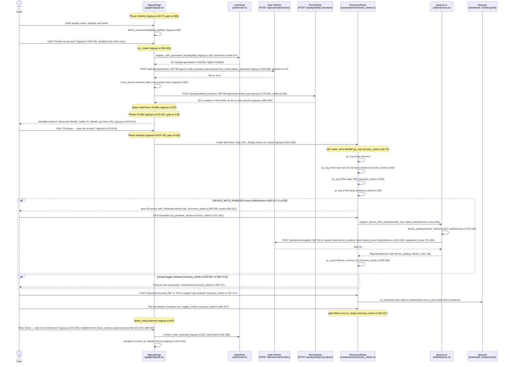

**Key invariants:**
- Private key is generated entirely in-WASM; never leaves the browser
  (`auth/mod.rs:344-414`).
- `provision_pod` is non-fatal: a failure is warned and the flow continues
  (`signup.rs:288-295`), because the lazy paths provision again on the first
  avatar upload that gets a 403 or 404 (`pages/settings.rs:654-665`, and
  `utils/pod_client.rs:21-44`, which self-heals through
  `provision_pod_signer`, `utils/pod_client.rs:46-78`).
- The "Done" button is disabled until `sheet_ready || advanced_override`
  (`signup.rs:674-676`). The gate propagates from `RecoverySheet::on_ready` →
  `sheet_ready.set(true)` (`signup.rs:647`).
- `real_name` is admin-only; it goes to the auth-worker with the claim and is
  never published to the relay or written to kind-0 (`signup.rs:118-122`,
  `130-135`, `253-256`).

**Drift:** the module comment at `signup.rs:4-5` still says the real name is
posted to `/api/profile/real-name`; the code posts it with the claim to
`/api/username/claim` (`signup.rs:118-168`).

---

## 2. `/connect` Magic-Link Login

Route `/connect` is intentionally NOT auth-gated — it is the route that
authenticates the device (`app.rs:950-953`).

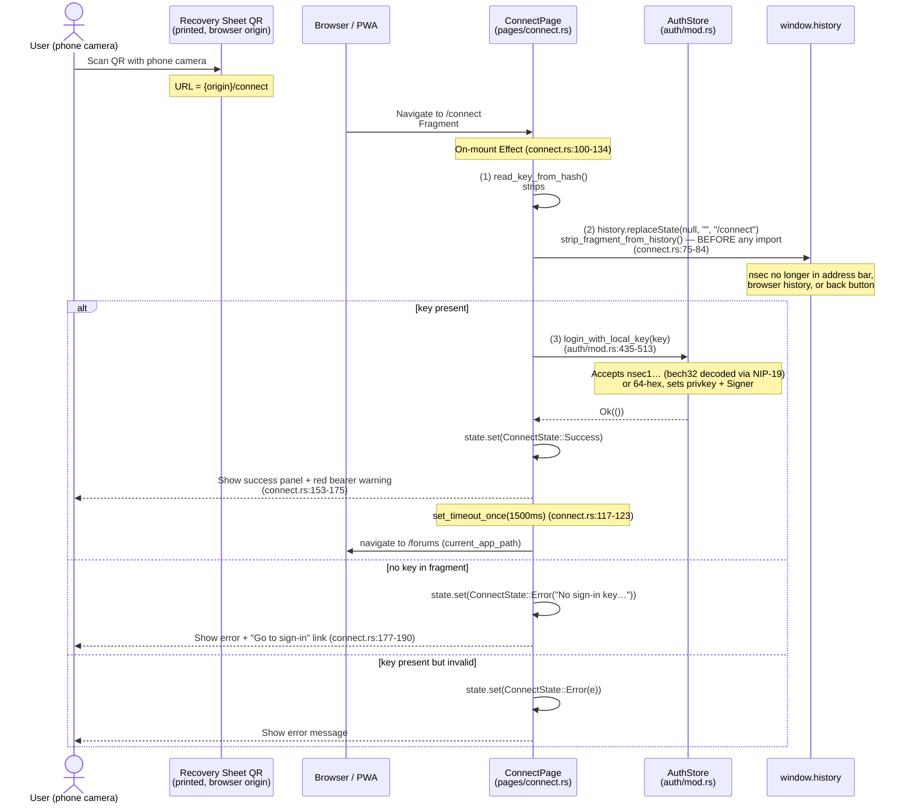

**Key invariants:**
- Fragment is read synchronously, then stripped, then imported — all three steps
  in one `Effect::new` closure with no `.await` between read and strip
  (`connect.rs:100-134`). The key cannot persist in history.
- The key never reaches the server: URL fragments are not sent in HTTP requests.
- Bearer credential warning is shown in red immediately on success
  (`connect.rs:158-166`).

---

## 3. BBS Navigation: Category → Section → Topic → Reply Threading

Three subscriptions feed the forum views, all opened with a receipt callback so a
page can tell "empty" from "not answered yet" (section 9):

- the **channel list** (`ChannelStore::start_sync`, `stores/channels.rs:356`):
  one REQ with two filters, kinds 40 and 41 with limit 1000 and, separately, kind
  5 with the device's `since` marker (`channel_sync_filters`,
  `channels.rs:1006-1016`; the kind-5 filter `deletion_filter`,
  `channels.rs:974-981`). Since PR #81 they are separate filters so a pile of
  deletions can never crowd the channel definitions out of the row budget
  (`channels.rs:993-1000`);
- the **broad message sync** (`start_msg_sync`, `channels.rs:560`): per-zone `#e`
  filters over the known channel ids plus one broad kind-42 catch-all
  (`message_sync_filters`, `channels.rs:1042`), so a busy zone cannot push a quiet
  zone's history out of its row budget (#81);
- the **per-channel history** (`ensure_subscribed`, `channels.rs:693`): kind 42
  with `#e` of the channel, called by the section page (`pages/section.rs:231`)
  and the thread page (`pages/thread.rs:431`), idempotent per channel.

The message sync no longer starts on the first EOSE. `App` starts it only once
the channel list has *settled*: an authenticated answer, or the deadline
(`channel_list_settled`, `utils/lookup.rs:140`; effect at `app.rs:889-913`),
because its per-zone filters are built from the channels known at that instant
and the pre-AUTH answer omits Hidden-zone channels.

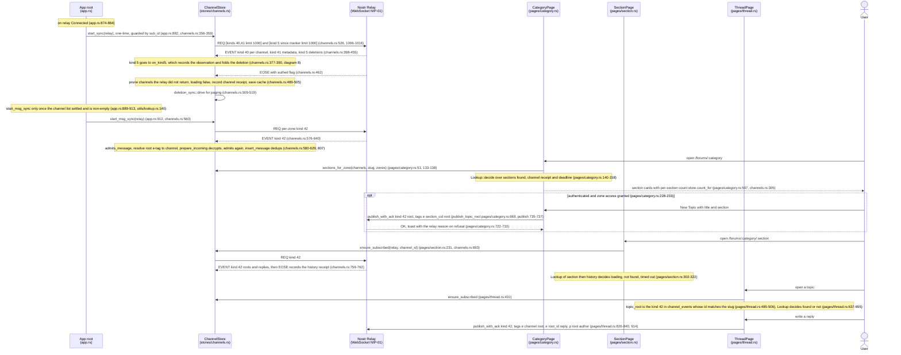

**Key design points:**
- `ChannelStore` subscribes globally once at app root; the pages do not open
  their own kind-40 or broad kind-42 subscriptions (the comment at
  `pages/category.rs:22-25` records the earlier duplicate).
- Message counts are derived exclusively from `channel_messages.len()` at
  runtime and never persisted as an independent field (ADR-091,
  `channels.rs:301-308`).
- The kind-42 subscription still resolves a root `e` tag against the channel id,
  name or section, because legacy relay data tags messages with slugs rather
  than kind-40 ids (`channels.rs:585-610`).
- Every insertion path asks one predicate, `admits_message`
  (`channels.rs:267-299`), so a deletion folded before its target arrives is
  still honoured (diagram 8).

---

## 4. Device Management

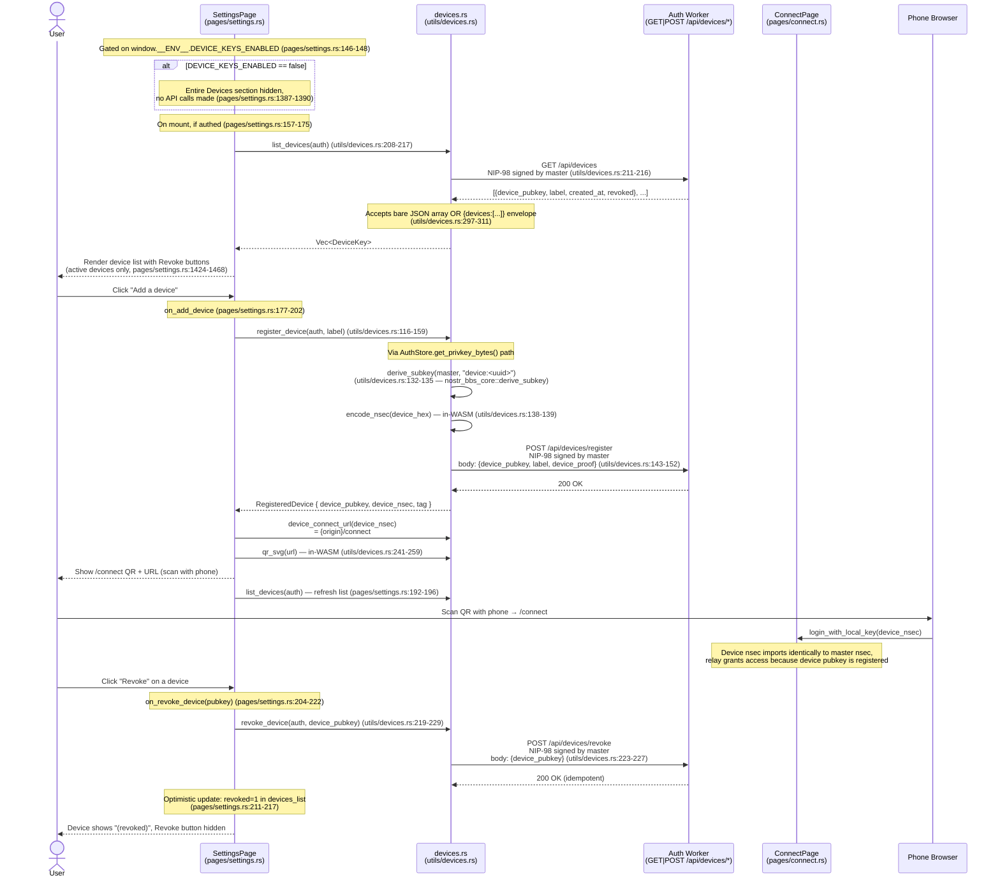

---

## 5. DM / Gift-Wrap Client Path

The whole path is `Signer`-based now: nothing needs a raw key, so NIP-07
extension users send and receive too. Pages call `auth.get_signer()` and pass an
`Rc<dyn Signer>` (`pages/dm_list.rs:98-116`, `pages/dm_chat.rs:70-95`), after
relay AUTH. Kind 4 uses `nip04_decrypt` (it is NIP-04, not NIP-44). A send
produces **two** wraps, one to the recipient and a self-copy, and the optimistic
local message is re-keyed to the self-copy id. The extended NIP-17 path
(`dm/routing.rs`, `rumors.rs`, `delivery.rs`, `requests.rs`, `consent.rs`, under
`RECIPIENT_KEYS_ENABLED`) is outside this diagram.

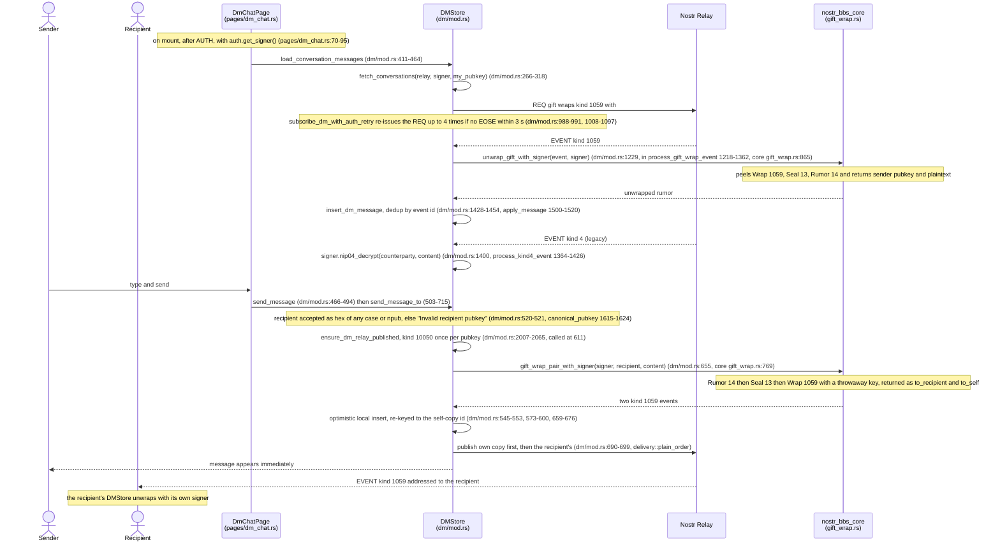

**Resolved (June findings F-06 / register O6):** a NIP-07 extension user is no
longer silently skipped. `subscribe_incoming` (`dm/mod.rs:320-368`) and
`fetch_conversations` take `Rc<dyn Signer>` with no early return on a missing
raw key. An extension without NIP-44 gets a state error (`dm/mod.rs:1253-1264`)
and a persistent banner (`pages/dm_list.rs:295-296`, `334-345`).

---

## 6. App-Root Relay Connection, NIP-42 AUTH and the REQ Ledger (PR #91)

`RelayConnection` (`relay.rs:262`) is one socket for the whole app, provided as
context. `App` creates it (`app.rs:448`), then an effect on `is_authenticated`
installs the AUTH signer (async for NIP-07, sync otherwise, `app.rs:461-476`) and
calls `connect()` (`app.rs:478`); signing out disconnects. Sends are paced to at
most 8 frames per second (`MAX_SENDS_PER_SECOND`, `relay.rs:46`, `queue_paced`
`relay.rs:286`) because the relay drops frames beyond its per-IP cap with only a
NOTICE.

What PR #91 added to the handshake:

- **`authenticated` flips only on the relay's `OK true` for the AUTH event.**
  The public `authenticated` signal used to mean "AUTH frame sent". Now the
  frame is recorded as `pending_auth` (`relay.rs:1459-1464`), the relay's `OK`
  with that event id is routed to `on_auth_ok` (`relay.rs:1389-1397`, `960`), and
  only `Accepted` runs `replay_after_auth` (`relay.rs:967-977`), which sets
  `auth_accepted` (`relay.rs:1161`), re-sends the REQs and COUNTs, flushes the
  held writes and finally sets the signal (`relay.rs:1209-1211`).
- **Writes are held until then.** `send_or_defer_write` (`relay.rs:769`) pushes an
  EVENT into `deferred_writes` while the socket is open but AUTH has not been
  accepted, refused or declared unnecessary (`relay.rs:772-781`). Public reads
  are never deferred.
- **Rate-limited AUTH is retried, a refusal is explained.** `classify_auth_ok`
  (`relay/receipt.rs:272-280`): a `rate-limited:` refusal is re-sent up to
  `AUTH_RETRY_LIMIT = 3` (`receipt.rs:42`, `relay.rs:978-1005`); any other
  refusal calls `refuse_auth` (`relay.rs:1006-1008`, `1018`), which records an
  `auth_note`, marks `auth_refused` and releases the held writes so the relay's
  own refusal reaches each publish callback, with `explain_write_refusal`
  (`receipt.rs:227`) turning a bare `auth-required:` into an explanation
  (`relay.rs:1414-1420`).
- **AUTH cannot stall for ever.** `arm_auth_stall_check` (`relay.rs:1046`) asks
  `release_held_writes` (`receipt.rs:214`) whether the handshake on this socket is
  unresolved and `auth_stalled` (`receipt.rs:250`): 60 s without a signature
  (`AUTH_SIGN_TIMEOUT_MS`, `receipt.rs:60`) or 10 s without an answer
  (`AUTH_ANSWER_TIMEOUT_MS`, `receipt.rs:67`). A stall releases the writes through
  `refuse_auth` (`relay.rs:1069-1070`). Timers carry `conn_gen`, bumped per socket
  (`relay.rs:497`, `582`), so a stale timer does nothing.

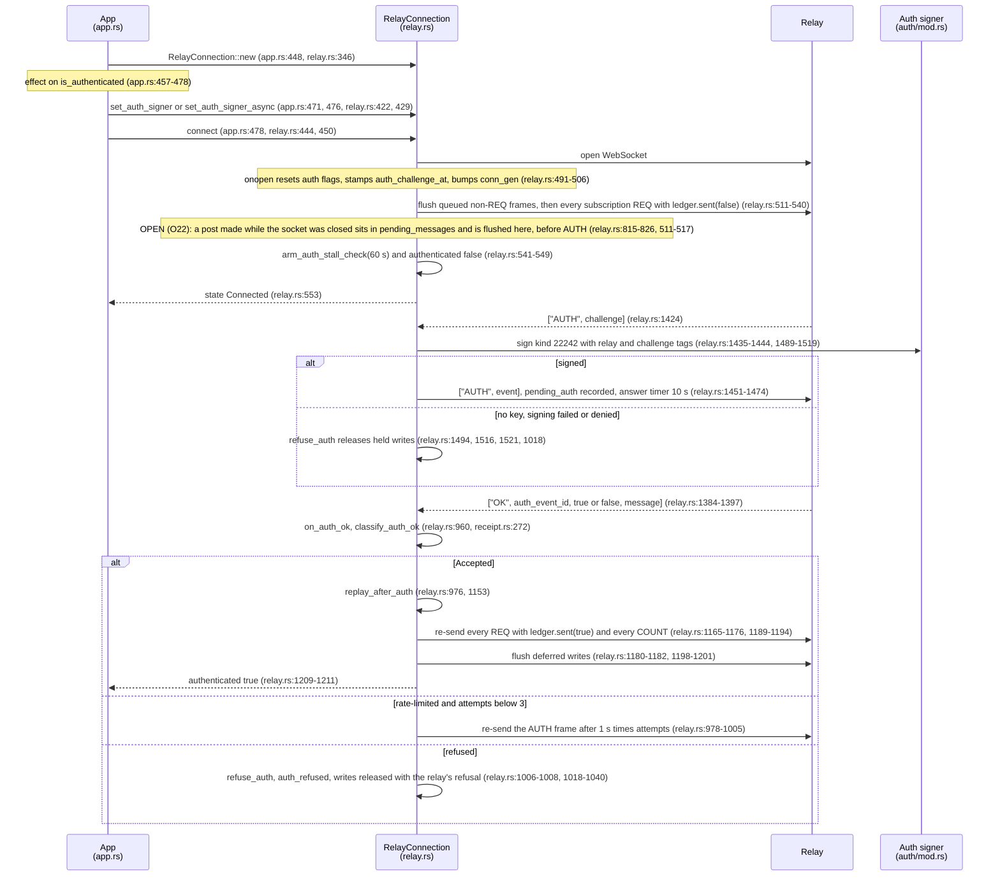

### The per-subscription REQ ledger

A NIP-42 relay evaluates each REQ against the session's authentication *at the
moment it starts it*, so a REQ sent before `OK true` is answered with the
anonymous view, which omits members-only events. The client then replays every
subscription under the same id. The two REQs can be in flight at once and the
relay does not promise to answer them in order (its REQ handler awaits D1,
`relay/receipt.rs:9-10`). `ReqLedger` (`receipt.rs:71`) therefore never guesses
which REQ an EOSE belongs to: `sent(authed)` counts a REQ out (`receipt.rs:97`),
`answered()` counts an EOSE in and reports "authenticated" only when every REQ
sent for the subscription has been answered and the latest went out after AUTH
was accepted (`receipt.rs:109-116`). The result reaches the page as the `authed`
flag of the EOSE callback (`relay.rs:1305-1316`) and is recorded as a
`SyncReceipt` (section 9).

The relay can also drop a REQ with nothing but a NOTICE (its per-IP cap, its
subscription cap), which names no subscription. `arm_req_watch` (`relay.rs:1101`)
is the per-REQ timeout (`REQ_ANSWER_TIMEOUT_MS = 8000`, `receipt.rs:50`, backed
off by `req_watch_delay`, `receipt.rs:238`): `on_watch` (`receipt.rs:131`) says
`Settled`, `Resend` or `GiveUp` after `REQ_RESEND_LIMIT = 2` (`receipt.rs:55`). A
re-send retires the wire id and goes out under a fresh one (`wire_id`,
`receipt.rs:158`, `relay.rs:1131-1136`) after a CLOSE of the old one
(`relay.rs:1142-1144`), so a late answer to the abandoned REQ arrives under a
retired id, `route()` says `Retired` (`receipt.rs:184`) and it never reaches the
ledger (`relay.rs:1303`).

**Invariant:** an answer is never credited to a REQ sent after it
(`relay/receipt.rs:31-33`).

**Invariant:** a subscription that reuses an id replaces the old one on the
relay, so the post-AUTH replay at a full session is not refused by the relay's
cap (relay-event-admission diagram 4, `subscription_cap_reached`,
`crates/nostr-bbs-relay-worker/src/relay_do/nip_handlers.rs:52-54`).

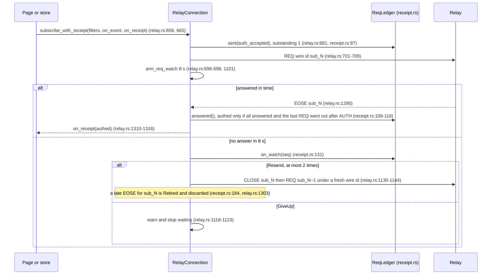

---

## 7. Preview Worker and Search Worker (Brief Survey)

### Preview Worker (`crates/nostr-bbs-preview-worker/`)

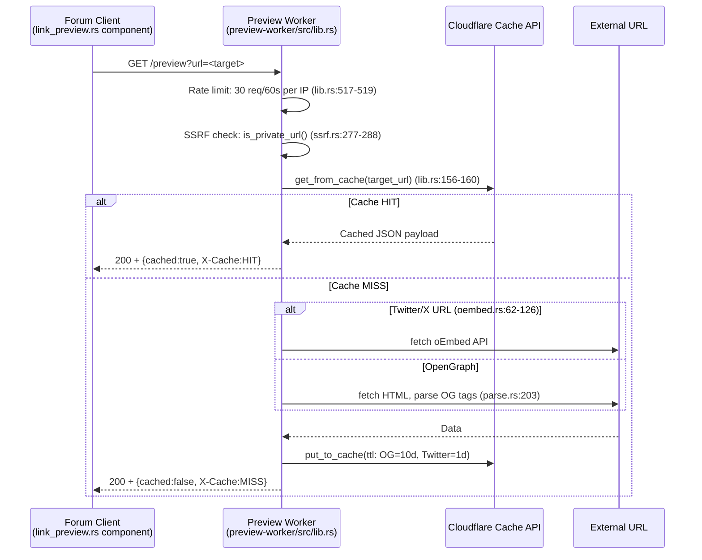

### Search Worker (`crates/nostr-bbs-search-worker/`)

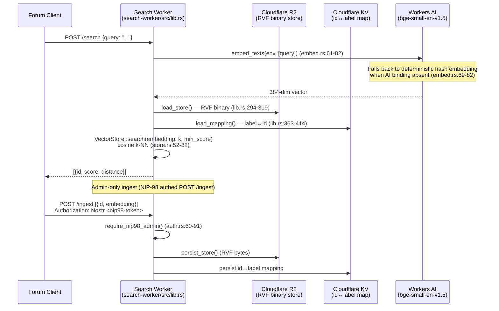

---

The preview worker also serves `/ascii` (`lib.rs:351`), `/health` (`lib.rs:470`)
and `/stats` (`lib.rs:482`), routed at `lib.rs:532-544`. The search worker rate
limits `/search` to 100 requests per 60 s per IP (`lib.rs:927-936`), refuses a
query whose embedding model does not match the store (`lib.rs:495-500`) and may
rerank (`lib.rs:509-543`). `POST /ingest` takes entries of id, embedding, public
and optional snippet, plus an optional model (`handle_ingest`, `lib.rs:712-875`),
with the admin check at `lib.rs:720-730` and the store persisted at
`lib.rs:836-844`.

---

## 8. Incremental kind-5 deletion sync (PR #93)

Without a marker every session asked the relay for the newest 1,000 deletions,
most already applied. A device that has completed a deletion sync now asks only
for deletions at or after a per-device `since` marker
(`stores/deletion_sync.rs:1-12`). The relay keeps NIP-09 tombstones, hard-deletes
every ordinary target it honours and refuses to store it again
(relay-event-admission diagrams 2 and 10), so a target whose kind-5 is older than
the marker is not served back.

**What is persisted.** Per scope (channels, reactions) one `localStorage` record
`nostrbbs_deletion_sync_v3_channels` or `..._reactions`
(`DeletionScope::storage_key`, `deletion_sync.rs:151-161`) holding
`DeletionSyncState { since, sealed, held }` (`deletion_sync.rs:166-177`). Only the
tombstones that hide a **restored sealed original** (ADR-2017) are kept across
sessions, because the relay hard-deletes ordinary posts: `sealed` for resolved
ones (the deleter was honoured) and `held` for kind-5 targets not yet resolved
(`deletion_sync.rs:60-90`). Caps: 256 resolved and 64 held per deleter, 1,024
each overall, trimmed to a fair share (`deletion_sync.rs:126-132`, `fair_trim`
`208`, `enforce_caps` `230`). Reactions keep a marker but hold no tombstones
(test `reaction_progress_holds_no_tombstones`, `deletion_sync.rs:1190`).

**Tombstones are `(id, deleter)`, never the id alone** (`stores/tombstones.rs:1-31`).
`honoured` (`tombstones.rs:114`) decides per target kind: for an **ordinary** post
every deleter counts, since the relay's kind-5 gate is the authority there; for a
**restored sealed original** only the verified inner author, or a pubkey the relay
positively vouches is an admin (`GET /api/check-whitelist` `isAdmin`,
`stores/signer_admin.rs:108`, `parse_is_admin` `122-128`, fail closed), or the
reader's own local delete. A kind-5 that arrives before its target is held with
its deleter and judged when the target arrives, so arrival order changes nothing
(`tombstones.rs:22-26`). `admits` (`tombstones.rs:131`) is the single predicate
every insertion path asks (`channels.rs:267-299`).

**The marker only advances when a sync has settled**, and is
`min(newest kind-5 delivered, local now)` minus 14 days (`next_marker`,
`deletion_sync.rs:266`; `DELETION_SINCE_MARGIN_SECS`, `deletion_sync.rs:119`):
twice the relay's 7-day `created_at` drift allowance
(`RELAY_MAX_TIMESTAMP_DRIFT_SECS`, `deletion_sync.rs:110`, mirrors
`MAX_TIMESTAMP_DRIFT`, relay `nip_handlers.rs:44`), which kind 5 does not escape.
A marked sync that fills the 1,000-row page pages downwards with
`until = oldest delivered` (inclusive, `deletion_page_filter`,
`channels.rs:987`), at most 20 pages (`MAX_PAGES`, `deletion_sync.rs:123`,
`next_page` `424`, `first_step` `402`). An unmarked first sync takes the newest
1,000 and never pages.

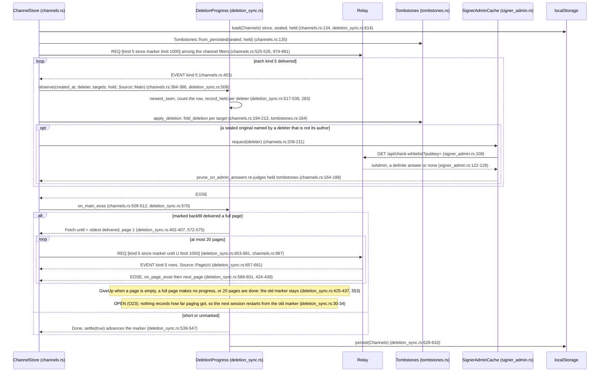

**Invariant:** a kind-5 accepted by the relay after a marker-advancing sync is at
or above that marker, so the next sync fetches it (`deletion_sync.rs:54-59`).

**Open (O23):** when paging gives up (20 pages, an empty page, or a full page
with every row at one `created_at`) the marker is not moved and the next session
starts again from the same `since` with no resume cursor
(`deletion_sync.rs:30-34`). A device more than 20,000 deletions behind therefore
re-fetches the same pages every session.

**Open (O25):** the client can vouch for an admin but not for a TL3 moderator
(`tombstones.rs:12-18`): a TL3's kind-5 of a sealed original does not hide it on
other clients, and is instead made real on the relay by removing the envelope
(relay-event-admission diagram 10). Separately, the `isAdmin` it asks for comes
from `check-whitelist`, which reads only `whitelist.is_admin`
(`crates/nostr-bbs-relay-worker/src/whitelist.rs:135-142`, `isAdmin` in the reply
at `whitelist.rs:180`), whereas the relay's own admin test also honours the static
`ADMIN_PUBKEYS` set (`relay-worker/src/auth.rs:181-191`). An admin that exists
only in `ADMIN_PUBKEYS` is an admin to the relay but is "not an admin" to the
client, so that admin's deletion of a sealed original is not honoured by clients.

---

## 9. Page lookup state: loading, found, not found, timed out (PR #91)

A cold deep link used to show "Topic Not Found" as soon as `ChannelStore::loading`
cleared, which says nothing about whether the kind-42 history had been requested
(`utils/lookup.rs:1-9`). The zone, section and topic pages now decide with
`Lookup::decide(found, synced, deadline_passed)` (`lookup.rs:91-102`):
presence beats everything, a receipt beats the clock, and only then the 15 s
deadline (`LOOKUP_DEADLINE_MS`, `lookup.rs:37`) gives `TimedOut`, reported
separately from `NotFound` so the page does not claim an absence it has not
observed (`lookup.rs:73-85`). `Lookup::then` chains a nested lookup: a topic is
looked up only once its section was found (`lookup.rs:106-111`).

"Synced" is a `SyncReceipt` (`lookup.rs:41-66`): `any` once any EOSE arrived,
`authed` once an EOSE was an *authenticated* answer, per the relay layer's REQ
ledger (section 6). `settles(zone_gated)` needs `authed` for a zone that is not
public, because the pre-AUTH answer omits members-only events by design
(`lookup.rs:62-68`), and `zone_is_gated` (`lookup.rs:123`) says which. The deadline
is a `DeadlineClock` re-armed per target, since Leptos reuses a route component
when only its params change (`DeadlineClock` `lookup.rs:150`, `deadline_for` `191`). The
receipts live in the store: `channel_receipt` (`channels.rs:90`, recorded at
`503`) and one per channel history (`history_receipts`, `channels.rs:96`, recorded
at `759-762`, read by `history_receipt` `682`).

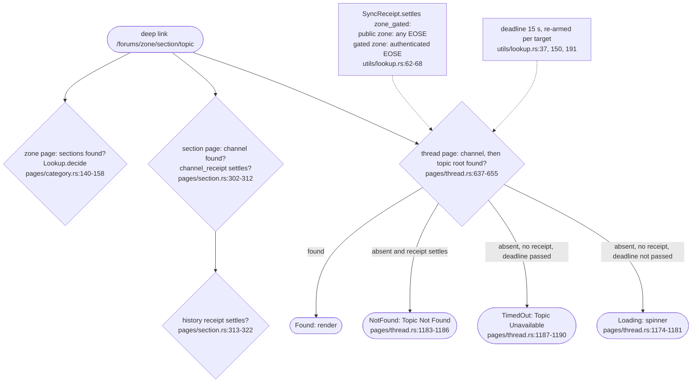

**Open (O21):** in an encrypted zone a cold deep link can still show "Topic Not
Found" between the authenticated answer and the arrival of the zone keys
(observed live on 2026-11-22, about 12 s to 29 s, after which it corrected
itself; a fix is in progress). What the code shows: the topic root is looked up
by event id among the channel's stored kind-42 events (`pages/thread.rs:485-506`);
a zone-encrypted message without its key is stored as a placeholder that keeps
its own id, tags and signature (`zone_crypto/store.rs:407-412`), so an ordinary
encrypted topic root should be found. The path to `NotFound` is read from the
code only for a **sealed migrated original**, which lives inside an envelope with
a different id until the key opens it and `redecrypt` replaces it under the
original id (`zone_crypto/store.rs:450`, `1202-1206`); the lookup has no input
for "keys not loaded yet" (`pages/thread.rs:637-655`, `utils/lookup.rs:91-102`).
So for such a topic, once the authenticated history receipt has arrived
(`channels.rs:759-762`) and before `redecrypt`, `topic_root` is `None`, the
receipt settles, and `Lookup::NotFound` renders (`pages/thread.rs:1183-1186`).
Whether the observed cases were all migrated topics, or whether another path
exists for ordinary encrypted topics, is not established. The timing is the observation; the
mechanism above is read from the code and was not reproduced.

---

## 10. Zone keys per signed-in identity (PR #92)

Zone keys are cached in IndexedDB, which every account on one browser profile
shares. Since #92 each row carries its owner in an `owner` field **and** in its
id, `"<owner pubkey>/<store id>"` (`zone_crypto/key_owner.rs:1-26`,
`owned_row_id` `key_owner.rs:69`, `StoredZoneKey::owned` `stores/indexed_db.rs:104`),
so two identities' rows never share an id and one cannot overwrite the other's.
The only key-write API takes an `Owner` (a validated 64-hex newtype,
`key_owner.rs:38-49`): `put_zone_key_unless_conflicting` (`indexed_db.rs:443`) and
`put_minted_zone_key` (`indexed_db.rs:466`).

**What an identity sees.** Its own rows, plus the legacy rows, minus any legacy
row it has its own row for (`visible_keys`, `key_owner.rs:172`, `slot_view`
`key_owner.rs:88`). A legacy row (no owner) cannot be attributed, so it stays,
is never written or deleted, and is seen by every signed-in identity on the
device and by nobody while signed out (`key_owner.rs:13-19`).

**The identity switch.** `provide_zone_key_store` follows auth
(`zone_crypto/store.rs:1162-1171`): the owner is set only while authenticated
(`owner_from_auth`, `key_owner.rs:60`), so a restored but locked session loads no
keys. On any change `switch_owner` (`store.rs:187`) drops the previous identity's
keys, conflicts, inbox key, grant subscriptions and held group signers, re-runs
decryption with no keys so plaintext goes back to placeholders
(`store.rs:187-206`), and loads the new identity's view under a fresh `Lease`
(`load_for` `store.rs:490`, `load_stored` `497`). Work for an earlier identity
still stores under its own owner but touches memory, the relay and the UI only
while its lease is current (`key_owner.rs:280-330`, `store.rs:799-847`).
Readiness is per owner (`ready_for`, `store.rs:153`), so the Encryption card
offers Create or Rotate only once the signed-in identity's keys are loaded
(`admin/zone_encryption.rs:192`).

**Other per-identity state.** Bookmarks are stored under
`nostrbbs_bookmarks:v2:<pubkey>` (or `anon` while signed out or locked) and keep
no text preview for an encrypted-zone message
(`components/bookmarks_modal.rs:1-15`, `bookmarks_key` `38-41`,
`bookmark_preview` `44`); drafts under `draft:v2:<pubkey>:<channel>`, with the
pre-owner `draft:<channel>` keys deleted once at start-up
(`components/draft_indicator.rs:44-54`, `drop_legacy_drafts` `84`); notifications
for an encrypted zone read "New encrypted message in <channel>" with no preview
and no author (`stores/notifications.rs`, see the PR #92 description). This is
isolation between accounts in the forum's UI, not access control: same-origin
storage is readable by any script on the origin or anyone with the device
(`key_owner.rs:21-24`).

**Open (O24):** keys written before #92 (legacy rows) and bookmarks saved before
it (the browser-wide `nostrbbs_bookmarks` key) cannot be attributed, so they stay
visible to every account that signs in on that browser
(`zone_crypto/key_owner.rs:13-19`, `components/bookmarks_modal.rs:1-15`);
removing a legacy bookmark removes it for all. Isolation covers keys received or
created from #92 on, and legacy previews are erased at start-up rather than the
bookmarks. (Pre-owner drafts, by contrast, are deleted outright,
`draft_indicator.rs:84`.)

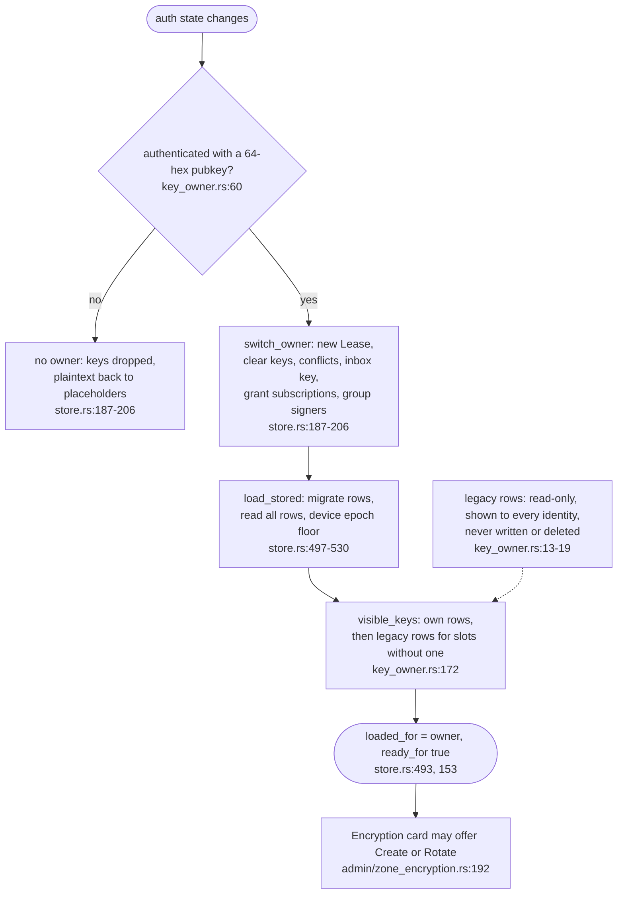

---

## 11. Minting, rotating and receiving keys: the epoch guards (PRs #83, #84, #87, #92)

Four guards stop two different keys ever sharing one `(zone, epoch)` or a key
being used before it reaches its members.

1. **Pending delivery (#83).** A key this device created is stored with
   `pending_delivery = true` (`zone_crypto/mod.rs:165-171`, set by the card at
   `admin/zone_encryption.rs:486-491`). It decrypts but is never chosen to send
   under: `send_key` (`keyset.rs:70`) drops any key pending in any row for that
   `(epoch, pubkey)` (`keyset.rs:78-95`), so a rotation whose grants fail cannot
   leave new posts readable only on this device. `mark_delivered`
   (`store.rs:343`) clears it once the relay has accepted the grants, and an echo
   cannot re-pend it (`store.rs:851-884`, `keep_pending` `323`).
2. **No second key for an epoch in use (#84).** `conflicts` (`zone_crypto/mod.rs:176`)
   says a different secret or pubkey for the same store id is a conflicting mint,
   never an update. Every key write is guarded: `put_decision`
   (`key_owner.rs:105`) over the identity's view (the legacy row counts),
   `insert_persisted` (`store.rs:799-889`, a conflict is recorded and the grant
   settled, `store.rs:816-826`) and `insert_local` (`store.rs:898-925`).
3. **Memory adopts storage on a conflict (#87).** If storage accepted a key but
   memory holds another (another tab's write), `adopt_stored` (`store.rs:272`,
   called at `store.rs:859`) makes memory match storage, never the reverse.
4. **Mint plan (#87, #92).** `plan_mint` (`keyset.rs:169`) returns `Wait` until the
   message sync has finished (`ready = msg_eose_received && keys_ready`,
   `admin/zone_encryption.rs:199-225`), `Blocked(reason)` for a keyless identity
   whose only evidence is a far-ahead epoch, or `Mint { epoch, note, higher_seen }`
   (`keyset.rs:129-153`). The epoch is above the identity's own latest, above every
   believable epoch named by a post, and above every epoch any row on the browser
   holds for the zone under any owner (`device_epochs_for`, `store.rs:161`; epoch
   numbers only). Neither a post nor another account's row is believed beyond
   `MAX_EPOCH_SKIP = 8` of what the identity can vouch for (`keyset.rs:125`,
   `plan_mint` `169-258`). A mint below an epoch seen in posts asks for explicit
   confirmation (`mint_confirmation` `keyset.rs:271`, card
   `admin/zone_encryption.rs:444-447`). The write re-checks in its own transaction
   (`put_minted_zone_key`, `indexed_db.rs:466`, `mint_decision`
   `key_owner.rs:131`), refusing a different key at or above the mint epoch held
   by the identity itself, or by another account within `MAX_EPOCH_SKIP`.

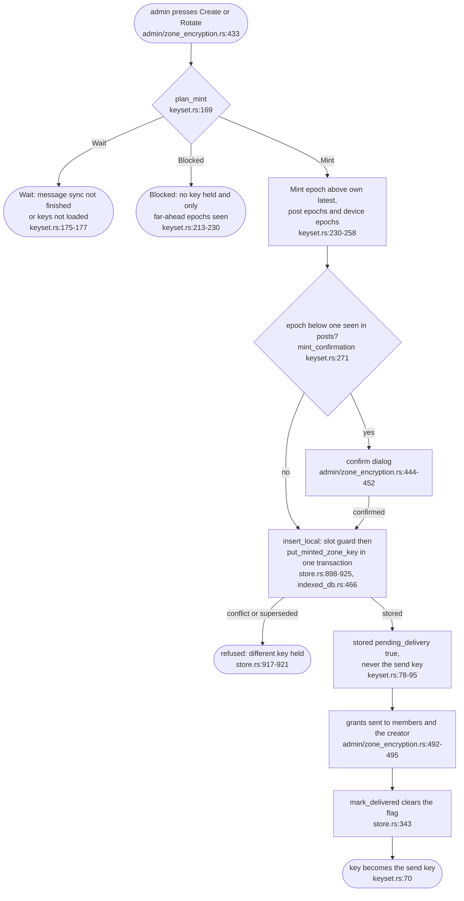

---

## Findings

Status at `3c48e26`. F-01 to F-12 keep their June numbering; F-13 onwards are new.

### F-01 — MEDIUM | `provision_pod` duplicated across modules — still holds, worse

**Files:** `pages/signup.rs:170-204`, `pages/settings.rs:2017-2052`,
`utils/pod_client.rs:46-78`

There are now three near-identical copies: signup, settings and the
self-healing `provision_pod_signer` in `utils/pod_client.rs`. The settings copy
(called at `pages/settings.rs:659`, now also on a 403) is redundant with
`utils/pod_client.rs:21-44`. **Classification:** Code duplication / maintenance
risk. (Register O8.)

---

### F-02 — MEDIUM | `qr_svg` duplicated: `recovery_sheet.rs` and `devices.rs` — still holds

**Files:** `components/recovery_sheet.rs:60-75`, `utils/devices.rs:241-259`

Identical `qr_svg(data: &str) -> String` using the same `qrcode` path. The
`recovery_sheet.rs` import at line 59 takes other `devices` symbols but not
`qr_svg`. **Classification:** Code duplication.

---

### F-03 — RESOLVED | `NIP05_USERNAME_HOST` hardcoded to `"example.test"` in `settings.rs`

~~`pages/settings.rs:30` hardcoded the host.~~ `settings.rs` now imports
`NIP05_HOST` from `components/onboarding_modal.rs` (`pages/settings.rs:35`), which
bakes it from `option_env!("NOSTR_BBS_NIP05_DOMAIN")`
(`components/onboarding_modal.rs:59-62`); a test asserts the two agree
(`pages/settings.rs:2411-2416`). `"example.test"` remains only as the
unconfigured-build fallback (`onboarding_modal.rs:61`). Signup no longer handles a
NIP-05 name at all. (Register O7.)

---

### F-04 — LOW | `/chat` route redirects to `/forums`; `ChatPage` is gone — amended

`/chat` still redirects to `/forums` (`app.rs:977`) and `/chat/:channel_id` still
routes to `AuthGatedChannel` (`app.rs:978`). `ChatPage` and `pages/chat.rs` no
longer exist, so the June claim that `ChatPage` remains reachable is stale; what
remains is `/chat/:channel_id` serving `ChannelPage`. **Classification:**
legacy URL alias.

---

### F-05 — MEDIUM | Two kind-42 subscriptions write one store — still holds, reshaped

`start_msg_sync` (`stores/channels.rs:560`) and `ensure_subscribed`
(`channels.rs:693`) both feed `channel_messages` through `admits_message` and
`insert_message` (`channels.rs:580-629`, `720-745`, `807`), which dedups. The
broad subscription is no longer a single unfiltered REQ: `message_sync_filters`
(`channels.rs:1042`) builds per-zone `#e` filters plus a broad catch-all (#81).
**Classification:** overlapping state authority / redundant relay traffic.

---

### F-06 — RESOLVED | DM subscriptions silently no-op for NIP-07 users

See section 5. `subscribe_incoming` (`dm/mod.rs:320-368`) takes a `Signer` with no
raw-key early return, and an extension without NIP-44 gets a state error
(`dm/mod.rs:1253-1264`) and a banner (`pages/dm_list.rs:295-296`, `334-345`).
(Register O6.)

---

### F-07 — MEDIUM | `DEVICE_KEYS_ENABLED` has no client-side deployment source — partly holds

**Files:** `utils/devices.rs:88-114`, `components/recovery_sheet.rs:360`,
`pages/settings.rs:148`

The flag is documented at `SETUP.md:171-174`, `docs/architecture.md:477` and
ADR-2004, but the client crate still has no `index.html`, `Trunk.toml` or script
that injects `window.__ENV__.DEVICE_KEYS_ENABLED`; only the docs describe the
client side. **Classification:** feature gate the UI reads with no in-crate source.

---

### F-08 — LOW | Relay URL read in two places with different fallbacks — still holds

**Files:** `relay.rs:1534-1553` (const `DEFAULT_RELAY_URL`, `relay.rs:29-30`),
`utils/relay_url.rs:7-15`, `relay_api_base` `utils/relay_url.rs:20-33`

`relay.rs` falls back to `wss://relay.example.com`; `relay_url.rs:13` falls back
to a different, real worker URL, and `relay_api_base` repeats it a third time.
**Classification:** duplicated relay-connection logic with diverging fallbacks.
(Register O8.)

---

### F-09 — LOW | Three manual auth gates beside the `auth_gated!` macro — smaller

`AuthGatedChannel` (`app.rs:1469-1494`), `AuthGatedDmList` (`1496-1521`) and
`AuthGatedDmChat` (`1523-1548`) are written out by hand; the macro is at
`app.rs:1565-1594` with its invocations at `1596-1608`. `AuthGatedChat` is gone.

---

### F-10 — RESOLVED | `onboarding_modal` imported in `settings.rs` but not rendered there

`pages/settings.rs:18-21` no longer imports `open_onboarding_with_prefill`, and
`OnboardingModal` is recorded as a removed dead component
(`components/onboarding_modal.rs:187-191`).

---

### F-11 — MEDIUM | NIP-49 `ncryptsec` still deferred; 0xchat confusion risk — still holds

`recovery_sheet.rs:46-50` records NIP-49 as deferred and `nostr-bbs-core/src` has
no NIP-49 support; the 0xchat "Login with QR" warning is at
`recovery_sheet.rs:469-472`. Correction: the download HTML has four sections, not
three.

---

### F-12 — AMENDED | `settings.rs` kind-0 subscription

`pages/settings.rs` still opens a `{authors:[pk], limit:1}` kind-0 subscription
each time its effect runs (`settings.rs:387-498`, subscribe `457-473`). It no
longer auto-unsubscribes after 5 s: it closes in `on_cleanup`
(`settings.rs:479`), and the 5 s timer only sets a `profile_load_slow` flag
(`settings.rs:488-497`). The app-root kind-0 subscription is unfiltered with
limit 500 (`app.rs:773-777`), so the redundancy point stands.

---

Written records of F-13 to F-18: KF-23, KF-24, KF-25, KF-26, KF-27, KF-28 in
`docs/security/known-findings.md`.

### F-13 — MEDIUM | Cold deep link in an encrypted zone can show "Topic Not Found" (O21)

Section 9. Topic lookup has no input for "zone keys not yet loaded".

### F-14 — MEDIUM | A post made while the socket is closed is flushed before AUTH (O22)

`send_or_defer_write` defers a write only while the socket is **open** and
unauthenticated (`relay.rs:772-781`). With the socket closed it goes straight to
`pending_messages` (`relay.rs:815-826`), and `onopen` drains those non-REQ frames
into the paced send queue (`relay.rs:511-517`, `535-537`) **before** the AUTH
challenge has been answered. In `nip42` mode the relay refuses such an EVENT with
`auth-required:` (relay-event-admission diagram 2, `nip_handlers.rs:1142`); the
publish callback then shows the explanation (`relay.rs:1414-1420`) only if an
`auth_note` exists, which it does not yet at that point. **Classification:** a
race the held-writes mechanism does not cover.

### F-15 — LOW | Deletion paging has no resume cursor when it gives up (O23)

Section 8.

### F-16 — MEDIUM | Legacy zone-key and bookmark rows are shared across accounts (O24)

Section 10.

### F-17 — MEDIUM | The client can identify admins but not TL3 moderators, and `isAdmin` omits static admins (O25)

Section 8.

### F-18 — LOW | Pod Browser's mesh card prints a raw error under "Details" (O26)

`pages/pod_browser.rs:1045-1061`: on a native-pod probe error the card renders
the error string `e` verbatim inside `
` (`detail = e.clone()`,
`pod_browser.rs:1049`, rendered at `1058-1059`); the personal-pod card does the
same (`pod_browser.rs:1172-1181`). `e` is the string error from the probe
(`pod_browser.rs:602`, `660`). Whether that string is a stack trace depends on
the failing call, and cannot be established from the code alone; it is not
sanitised either way.

---

*Verified against `origin/main` `3c48e26` on 2026-11-22. All file:line references
are to `crates/nostr-bbs-forum-client/src/` unless otherwise noted.*
