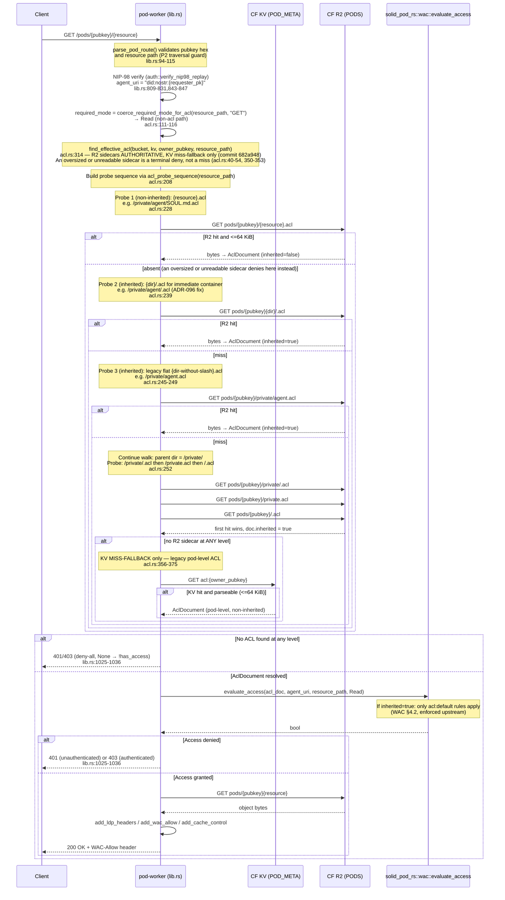
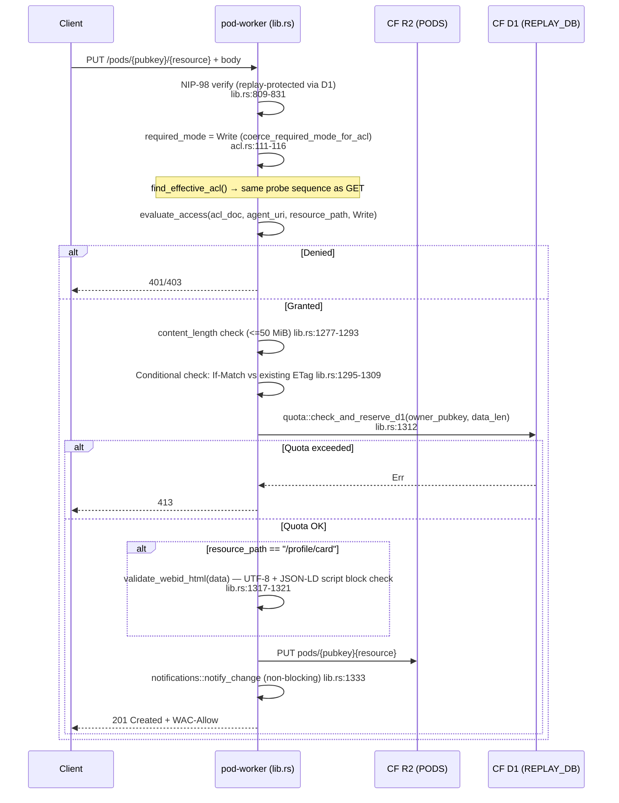
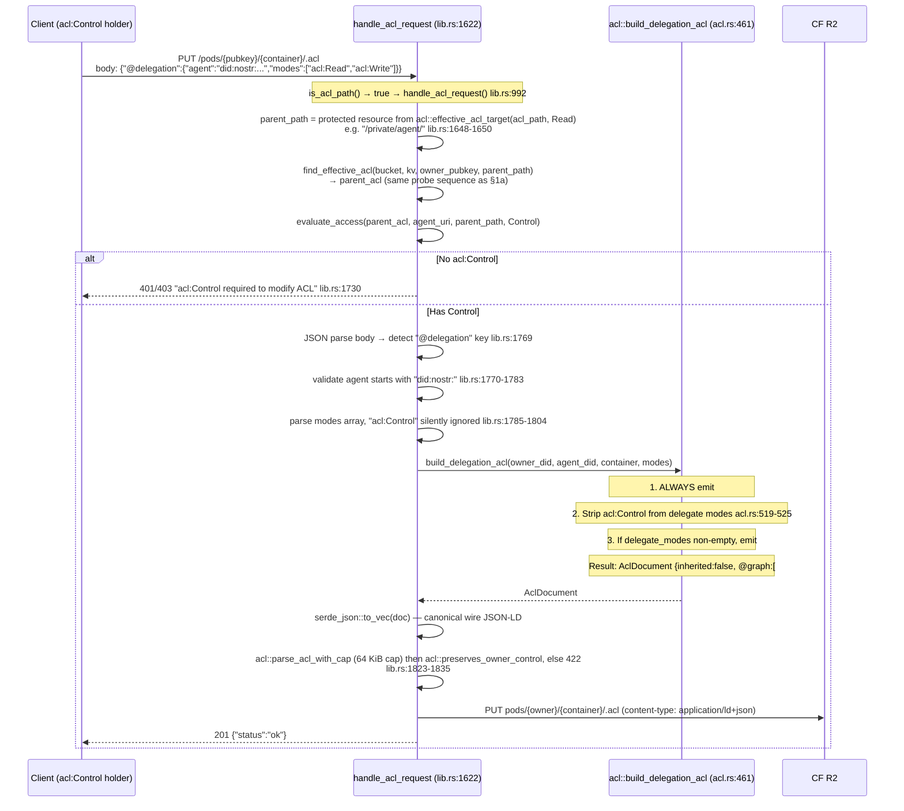
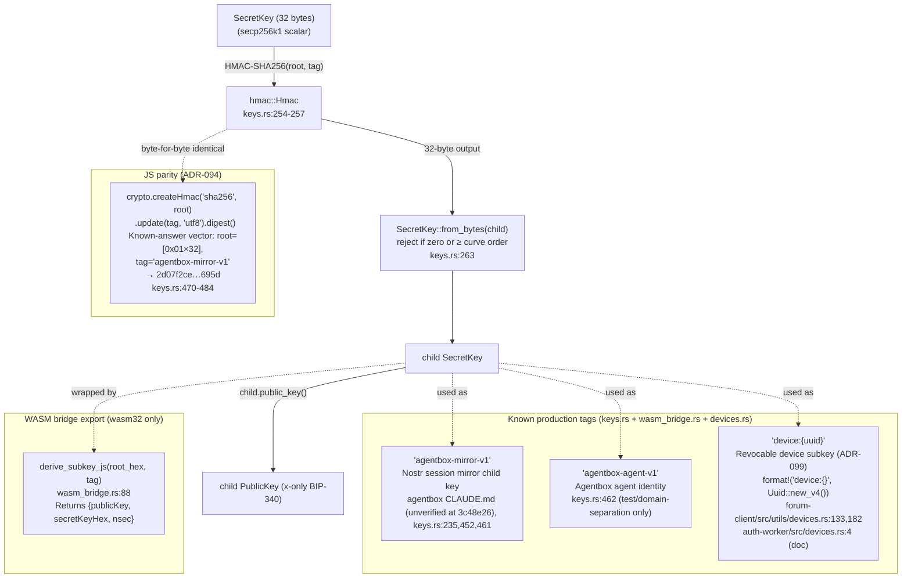
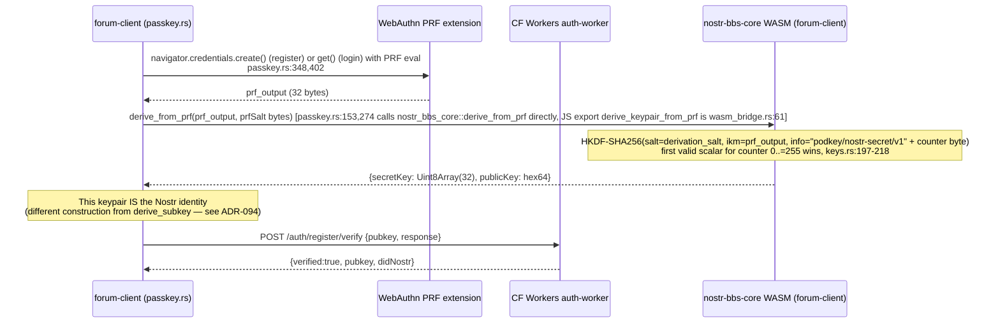
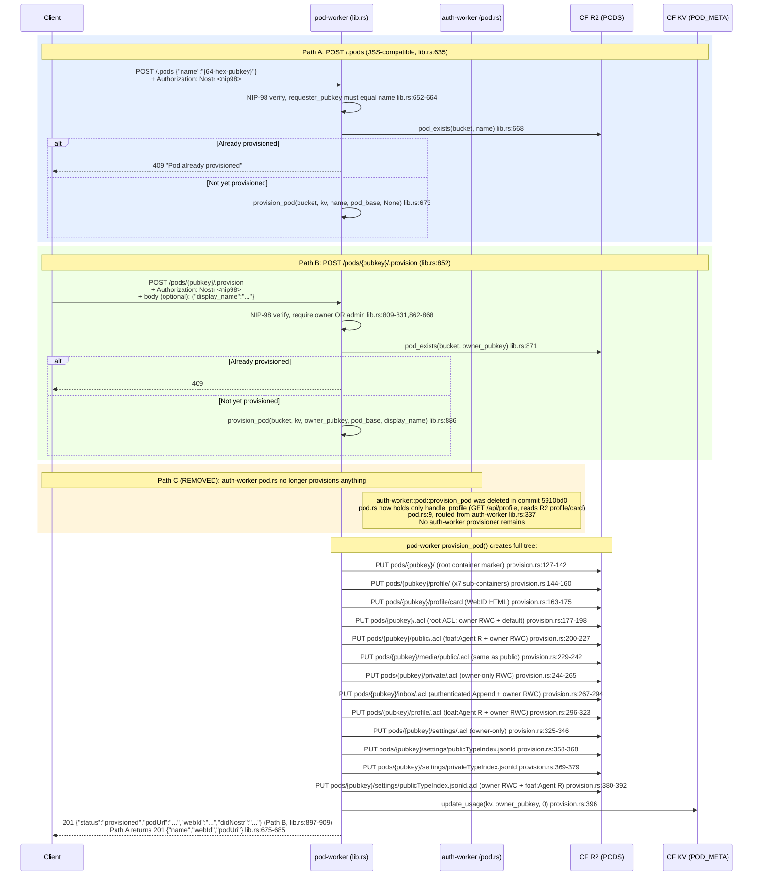

# Pod ACL and Identity Layer — Cartography Audit

Generated from source code. All file:line references are to the live codebase,
re-verified against `origin/main` `3c48e2656d7cabefa894a59b827f5f0d3a8b32b7` (v1.0.0-beta.21-rc.2, 2026-11-22).

---

## 1. Pod Resource GET/PUT with WAC Authorisation

The `find_effective_acl` resolver in `crates/nostr-bbs-pod-worker/src/acl.rs:314`
drives every request. It is called from two places in `lib.rs`:

- Line 1016 — standard resource flow (GET, PUT, POST, PATCH, DELETE)
- Line 1653 — ACL resource flow (`handle_acl_request`), for the *parent* resource

> **Resolution-order change (commit 682a948):** the R2 sidecar walk is now
> AUTHORITATIVE and runs first; the KV `acl:{owner_pubkey}` key is a legacy
> pod-level document consulted ONLY when no R2 sidecar resolves at any level.
> The previous KV-first fast path let a stale owner-granular KV entry shadow
> every R2 sidecar — including ADR-096 delegation grants (former Finding 1,
> now resolved). The pure ordering lives in `resolve_effective_acl`
> (`acl.rs:421`, `#[cfg(test)]` only at `acl.rs:420`; the live `find_effective_acl`
> inlines the same R2-then-KV order at `acl.rs:320-375`) for unit testing.

### 1a. GET /pods/{pubkey}/{resource} — Full ACL Walk

### 1b. PUT /pods/{pubkey}/{resource} — Write Path

---

## 2. Delegation Grant: PUT `{"@delegation":{...}}` to Container Sidecar

This is the "structured grant" shortcut documented in ADR-096.
The ACL-write handler in `lib.rs:1753-1818` detects the `@delegation` envelope
before the generic JSON-LD path and calls `build_delegation_acl` in `acl.rs:461`.

**Owner lock-out invariant**: `build_delegation_acl` always re-emits the owner's
`[Read, Write, Control]` grant regardless of what the caller requested. The delegate
never receives `acl:Control` even if `"acl:Control"` is included in the modes array
— it is silently dropped at `acl.rs:521-525` (and ignored at `lib.rs:1794`).

---

## 3. Identity Derivation: `derive_subkey` HMAC-SHA-256

Defined in `crates/nostr-bbs-core/src/keys.rs:252`.
Scheme (ADR-094): `child_sk = HMAC-SHA-256(key=root_sk_32bytes, msg=utf8(tag))`.

### 3a. PRF Key Derivation (separate construction — HKDF-Expand)

`derive_from_prf` (HKDF-Expand, keys.rs:197) and `derive_subkey` (HMAC, keys.rs:252)
are intentionally different constructions. The PRF path produces the **root** identity
keypair from the authenticator secret. `derive_subkey` produces **child** keys from
that root.

---

## 4. Pod Provisioning — Eager `provision_pod`

There are two entry points that trigger provisioning. Neither is triggered
automatically during WebAuthn `register_verify` — provisioning is an explicit
separate call.

---

## Findings

### Finding 1 — RESOLVED (commit 682a948) | KV Fast-Path Masked R2 Sidecars

**File**: `crates/nostr-bbs-pod-worker/src/acl.rs:314-376`
**Classification**: Fixed design gap

~~The KV fast-path read `acl:{owner_pubkey}` FIRST and returned unconditionally
on a hit, shadowing every R2 sidecar — so delegation grants written into R2
(via `build_delegation_acl`) were unreachable for pods carrying that KV key.~~
Fixed at the single resolver every access decision funnels through:
`find_effective_acl` now runs the most-specific-first R2 probe sequence first
and authoritatively; the legacy pod-level KV key is consulted only when no R2
sidecar resolves at any level, so it can never mask a more-specific R2
delegation sidecar. The ordering is extracted into the pure
`resolve_effective_acl` helper (`acl.rs:421`, `#[cfg(test)]` only, with its regression tests
calling it at `acl.rs:1416-1514`; the live resolver inlines the same order at `acl.rs:320-375`).
The auth-worker `pod::provision_pod` — the only writer of the masking KV key — has since
been deleted (see Finding 4).

---

### Finding 2 — RESOLVED (commit 6ef842b) | Duplicated `is_acl_path` / `path_is_acl` Predicate

**File**: formerly `crates/nostr-bbs-pod-worker/src/acl.rs:53-55` and
`crates/nostr-bbs-pod-worker/src/lib.rs:119-121`; now `lib.rs:118-120` only
**Classification**: Duplication / maintenance risk

~~`acl.rs` defines a private `fn path_is_acl(path: &str) -> bool { path.ends_with(".acl") }`
and `lib.rs` defines an identical private `fn is_acl_path(path: &str) -> bool { path.ends_with(".acl") }`.
They are the same predicate with different names. `lib.rs` could simply call the
public surface from `acl.rs` (which already exports `coerce_required_mode_for_acl`
that internally uses `path_is_acl`), or `acl.rs` could export `path_is_acl` and
`lib.rs` can import it. A future maintainer who changes the predicate in one place
(e.g. to also match `.acl.gz` for compressed ACLs) will silently miss the other.~~

Resolved: `path_is_acl` no longer exists in `acl.rs`. `coerce_required_mode_for_acl` (`acl.rs:111-116`)
now delegates sidecar detection to the shared `effective_acl_target` re-exported from
`solid_pod_rs::wac` (`acl.rs:36-38`, called at `acl.rs:115`), and the pod-worker's `.acl`
handler uses the same function (`lib.rs:1648-1650`). The only local predicate left is
`is_acl_path` (`lib.rs:118-120`), used for routing at `lib.rs:296` and `lib.rs:992`.

---

### Finding 3 — PARTLY RESOLVED (HEAD 3c48e26) | `parse_acl_with_cap` and `parse_acl_text_with_cap` are Private but Mentioned in Module Doc as Kit-Specific

**File**: `crates/nostr-bbs-pod-worker/src/acl.rs:12-13`, functions at `acl.rs:137` and `acl.rs:168`
**Classification**: Export/visibility inconsistency

~~The module-level doc comment (`acl.rs:12-13`) calls out both `parse_acl_with_cap`
and `parse_acl_text_with_cap` as named kit-specific extensions alongside
`find_effective_acl` and `coerce_required_mode_for_acl`, all of which are
described as the public kit surface. However `parse_acl_with_cap` (line 137) and
`parse_acl_text_with_cap` (line 168) are declared `fn` (private). This is a doc/
visibility mismatch. If callers outside the module ever need to apply the size cap
independently (e.g. a future partial-ACL merge path), they cannot without
duplicating the cap logic. Either make them `pub(crate)` to match the doc intent,
or remove them from the module doc description.~~

Amended: `parse_acl_with_cap` is now `pub` (`acl.rs:137`) and is used by the pod-worker's ACL PUT
handler (`lib.rs:1823`), so the visibility mismatch is gone for it. `parse_acl_text_with_cap` is now
`#[cfg(test)]` (`acl.rs:167-168`) yet the module doc still lists it as a kit extension
(`acl.rs:12-13`): only that doc nit remains.

---

### Finding 4 — RESOLVED (commit 5910bd0) | Auth-Worker `pod::provision_pod` Is Dead Code as a Provisioner

**File**: formerly `crates/nostr-bbs-auth-worker/src/pod.rs:29-113` (function deleted)
**Classification**: Dead code / architectural drift

~~`pod::provision_pod` in the auth-worker is never called for actual provisioning.
It is defined at `pod.rs:29` and the only call to `pod::` in `lib.rs` is at
line 318 (`pod::handle_profile`). Provisioning is performed by the pod-worker's
own `provision::provision_pod` (`pod-worker/src/provision.rs:106`), reachable via
`POST /.pods` or `POST /pods/{pubkey}/.provision`.~~

~~The two implementations have diverging behaviour:
- `auth-worker::pod::provision_pod` writes only 3 objects (KV ACL, R2 profile
  card, KV meta) with a single flat ACL document in KV.
- `pod-worker::provision::provision_pod` writes 13+ R2 objects (per-container
  ACLs, TypeIndex documents, WebID HTML, sub-containers) and no KV ACL entry.~~

~~If `auth-worker::pod::provision_pod` were ever wired into a signup flow, it would
produce an under-provisioned pod with a legacy KV ACL. Since commit 682a948 the
resolver treats that KV key as a miss-fallback only (it can no longer suppress R2
sidecars — former Finding 1), but the function remains an under-provisioning dead
path flagged for deletion.~~

Resolved: `crates/nostr-bbs-auth-worker/src/pod.rs` now contains only `handle_profile` (`pod.rs:9`),
routed from `crates/nostr-bbs-auth-worker/src/lib.rs:337`. There is no `provision_pod` in the
auth-worker. The sole provisioner is the pod-worker's `provision::provision_pod`
(`provision.rs:111`), reached via `POST /.pods` (`lib.rs:635`, call at `lib.rs:673`) and
`POST /pods/{pubkey}/.provision` (`lib.rs:852`, call at `lib.rs:886`).

---

### Finding 5 — LOW | WASM Bridge Exports Without Production JS Consumers

**File**: `crates/nostr-bbs-core/src/wasm_bridge.rs`
**Classification**: Dead export surface

The following `#[wasm_bindgen]` exports in `wasm_bridge.rs` have no production JS
consumers in the repo. They appear only in the benchmark harness
(`benchmarks/js-vs-wasm/bench.mjs`) or not at all:

| Export | File:Line | Benchmark only | No consumers found |
|--------|-----------|---------------|--------------------|
| `create_nip98_token` | `wasm_bridge.rs:120` | Yes (bench.mjs:38, noted to panic in WASM due to `SystemTime`) | — |
| `verify_nip98_token` | `wasm_bridge.rs:141` | — | No JS caller found |
| `verify_nip98_token_at` | `wasm_bridge.rs:159` | — | No JS caller found |
| `schnorr_verify` | `wasm_bridge.rs:249` | — | No JS caller found |

`derive_keypair_from_prf`, `schnorr_sign`, `compute_event_id`, and `nip44_encrypt`/
`nip44_decrypt` are used in the benchmark. `derive_subkey_js` and
`generate_keypair` are consumed by `forum-client` via the Rust WASM target (not
via the exported JS symbols directly, since `forum-client` is itself a Rust WASM
crate). The four symbols above have no identified JS callers; `create_nip98_token`
is additionally documented in the benchmark to panic in WASM due to
`std::time::SystemTime::now()` being unavailable. These should either gain
consumers or be removed from the public WASM surface to reduce the compiled
bundle size.

---

### Finding 6 — RESOLVED (commit c0fd600) | `key_provisioning.rs` and `nip05_endpoint.rs` Are Permanently-Parked Stubs

**File**: formerly `crates/nostr-bbs-pod-worker/src/key_provisioning.rs` and
`crates/nostr-bbs-pod-worker/src/nip05_endpoint.rs` (both deleted)
**Classification**: Dead module / maintenance debt

~~Both modules compile to a single `const _: () = ();` line. They are gated behind
`#[cfg(feature = "solid-pod-rs-phase1")]` which is never enabled in the workspace.
The comments document why: `key_provisioning` requires `solid-pod-rs-idp` (a sibling
crate not depended on), and `nip05_endpoint` requires actix-web (incompatible with
the CF Workers runtime). Neither blocker is in the near-term roadmap per the
consumer-surface-map. The modules exist only as source-level breadcrumbs but add
noise to `lib.rs:40-42` (`mod export; mod key_provisioning; mod nip05_endpoint;`).
They should be removed or moved to a `//! TODO: Phase 1` ADR comment until
activation is realistic.~~

Resolved: both files are gone from `crates/nostr-bbs-pod-worker/src/`, and the comment at
`lib.rs:37-40` records that the `provision-keys` and `nip05-endpoint` shims were removed.
The one remaining staging shim is `mod export;` (`lib.rs:41`), gated by `solid-pod-rs-phase1`
(`Cargo.toml:22`, `export.rs:17`).

---

### Finding 7 — INFO | `acl_probe_sequence` Legacy Flat `{dir}.acl` Form Remains Reachable — Noted, Not a Bug

**File**: `crates/nostr-bbs-pod-worker/src/acl.rs:237-253`
**Classification**: Informational

The resolver retains the legacy flat-sidecar probe (`/private/agent.acl` for a
resource under `/private/agent/`) interleaved between the container sidecar probe
(`/private/agent/.acl`) and the grandparent container probe. This is intentional
for backward-compatibility during migration (documented at `acl.rs:172-204`). Newly
provisioned pods write container sidecars (`{dir}/.acl`) per `provision.rs`. Older
pods may have only flat sidecars. Both remain reachable with correct precedence
(own > container > legacy flat > ancestor). No action required.
