# Relay Event Admission — Mermaid Diagrams

Cartography built from actual source code, not documentation.
All file:line citations reference `crates/nostr-bbs-relay-worker/src/` unless a
path is given in full.

> **Verified against** `origin/main` `3c48e2656d7cabefa894a59b827f5f0d3a8b32b7`
> (v1.0.0-beta.21-rc.2, 2026-11-22). Every line number below was re-derived from
> the symbol at that revision. The previous stamp was the 2026-06-12 sweep
> (commit 98cf18e); between the two, `relay_do/nip_handlers.rs` grew from about
> 1,350 to 8,082 lines (governance receipts, recipient keys, zone groups, the
> member deletion gate), so most earlier anchors had moved and diagrams 1, 2, 4,
> 5, 6, 7 and 8 were redrawn. Diagrams 9 to 11 are new (NIP-09 deletion).

Markers used in place (collected in `00-anomaly-register.md`): `**Open (Oxx):**`
a gap the code leaves, `**Debt (Oxx):**` something the authors flag or a reader
would, `**Drift:**` a comment or doc that disagrees with the code,
`**Invariant:**` a property the design depends on, with the line that enforces
it, `**Resolved (Rxx):**` an earlier finding the code now fixes. Inside a
diagram the same words appear as `OPEN:`, `DEBT:`, `INVARIANT:` in a note.

---

## 1. WebSocket Connect → NIP-42 AUTH → Session Scope Establishment

The worker forwards a `Upgrade: websocket` request straight to the `RELAY` Durable
Object (`lib.rs:231-232`); NIP-98 is not checked on the upgrade, and the
session is authenticated afterwards by NIP-42. The entry point is `DurableObject::fetch` in `relay_do/mod.rs:146`. It refuses
a non-WebSocket request (`mod.rs:147-149`), checks the per-IP connection cap
(`MAX_CONNECTIONS_PER_IP = 20`, `mod.rs:68`, enforced by
`reserve_connection_slot` at `mod.rs:162`), allocates a session id
(`mod.rs:184`), accepts the socket with `sid:` and `ip:` tags (`mod.rs:188-191`),
creates a `SessionInfo` (`relay_do/session.rs:20-28`) with `authed_pubkey: None`
(`mod.rs:196-205`), persists the challenge (`mod.rs:213`) and sends
`["AUTH", challenge]` (`mod.rs:219`). The challenge is a 128-bit CSPRNG draw
XOR-mixed with the session id (`session.rs:459-465`). The session survives
Durable Object hibernation through the tagged WebSocket and the `ws_*` keys in
DO storage (diagram 8).

An `AUTH` frame is rate-limited first (`mod.rs:323`) and then handled by
`handle_auth` (`nip_handlers.rs:2124`), which delegates every check to the pure
`nip42::evaluate_auth_event` (`relay_do/nip42.rs:195`): kind 22242
(`nip42.rs:202`), strict signature (`nip42.rs:206`), challenge tag equal to the
session's challenge (`nip42.rs:212-216`), the `relay` tag matching one of the
configured relay URLs (`nip42.rs:224-234`, `allowed_relay_urls` at
`nip42.rs:250`) and a `created_at` within 600 s (`nip42.rs:237`,
`AUTH_MAX_SKEW_SECS` at `nip42.rs:35`). On success the session's
`authed_pubkey` is set and persisted (`nip_handlers.rs:2149-2156`) and the relay
answers `["OK", id, true, ""]` (`nip_handlers.rs:2157`): that `OK true` is the
signal the client waits for (client-onboarding diagram 6).

The device-key attribution path (ADR-099) is resolved on demand, not on AUTH:
`device_keys_enabled()` (`nip_handlers.rs:3735`) reads the
`DEVICE_KEYS_ENABLED` Worker var, `device_owner()` (`nip_handlers.rs:3752`)
queries `device_keys WHERE device_pubkey = ?1 AND revoked = 0`, results are
memoised per pubkey by `cached_device_owner` (`nip_handlers.rs:2338`), and
`effective_pubkey()` (`nip_handlers.rs:3779`) calls the pure
`effective_principal()` (`nip_handlers.rs:1006`). The kind-1059 `#p` filter is
deliberately NOT rebound to the owner: `resolve_viewer_context` keeps
`session_pubkey` for wrap routing and uses `access_pubkey` only for zone and
cohort scope (`nip_handlers.rs:2271-2302`).

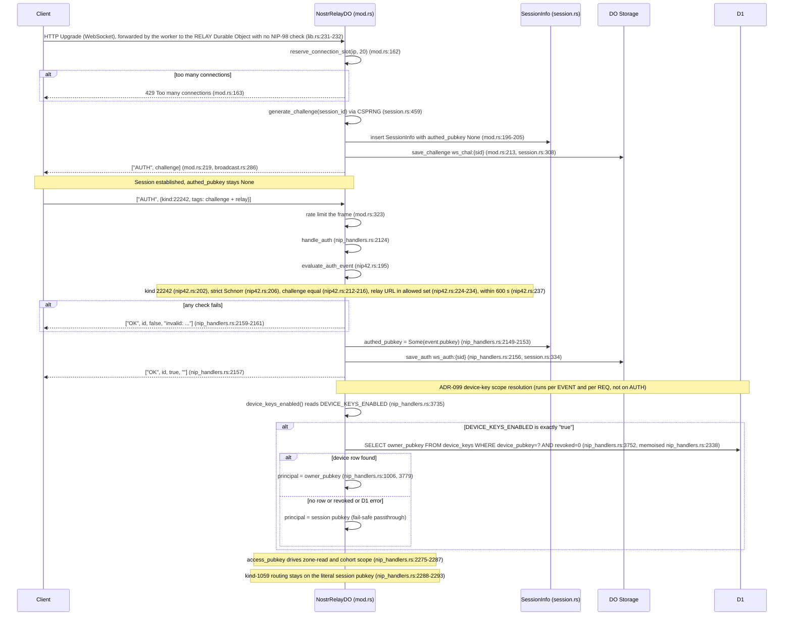

---

## 2. EVENT Admission Pipeline

`handle_event` (`nip_handlers.rs:1089-1726`) is the single admission gate for
every incoming EVENT. It is a linear waterfall: a failing check sends
`["OK", id, false, ...]` and returns. The diagram is split in two: 2a is
everything before the event is stored, 2b is what runs after it is.

What changed since the June map: the rate limit is 30 frames per second per IP
by default and is read from `RATE_LIMIT_MSGS_PER_SEC` (`broadcast.rs:190-235`),
a NIP-42 write gate sits before everything that costs a D1 read
(`nip_handlers.rs:1142`, `nip42.rs:297`, mode from `AUTH_MODE`,
`nip_handlers.rs:1059`), admission is judged on a `principal` that is the device
owner when ADR-099 is on (`nip_handlers.rs:1161`), the ban gate now covers every
user-authored kind in `is_ban_gated_kind` rather than kinds 1 and 42
(`nip_handlers.rs:77`, `1245-1254`), and an event that was deleted is refused
before it is stored (`nip_handlers.rs:1607-1611`, PR #89).

The NIP-59 gift-wrap split (`nip_handlers.rs:1175-1185`) is still the most
significant branch: a kind-1059 is admitted on its **recipient** `p` tag
(`gift_wrap_recipient`, `nip_handlers.rs:160`), through
`gift_wrap_recipient_verdict` (`nip_handlers.rs:2352`), because the author is a
fresh random key per message and would never be whitelisted. A declared ingress
recipient is admitted without a D1 row (`nip_handlers.rs:1179-1181`).

Admin status is `AdminCache.is_admin()` (`auth.rs:103`), a **30-second** TTL
in-memory cache (`auth.rs:46`) over `query_is_admin` (`auth.rs:181`): the static
`ADMIN_PUBKEYS` var first, then `whitelist.is_admin` (diagram 6).
`admin_cache.is_admin` is called twice for the same pubkey on a ban-gated kind
(`nip_handlers.rs:1246` then `1258`): the second is a cache hit.

```mermaid
flowchart TD
    START([CLIENT sends EVENT])
    RL{check_rate_limit per IP<br/>default 30 frames per s<br/>nip_handlers.rs:1097<br/>broadcast.rs:195, 235}
    RATE_FAIL([NOTICE: rate limit exceeded])
    STRUCT{validate_event: id, pubkey, sig lengths,<br/>content size, 2000 tags, 7 day drift<br/>nip_handlers.rs:1103, 1728-1755, 1793}
    STRUCT_FAIL([OK false: event validation failed])
    EXP{NIP-40 expiration tag<br/>past or not unix seconds?<br/>nip_handlers.rs:1110<br/>filter.rs:375}
    EXP_FAIL([OK false: expired or malformed])
    SIG{verify_event_strict<br/>nip_handlers.rs:1117}
    SIG_FAIL([OK false: id or sig failed])
    WAUTH{AUTH_MODE nip42 and<br/>session not authed?<br/>nip_handlers.rs:1142<br/>nip42.rs:297}
    WAUTH_FAIL([OK false: auth-required])

    PRINC[principal = device owner when ADR-099 on,<br/>raw key for gift wraps<br/>nip_handlers.rs:149, 1161, 3779]
    GIFT{kind 1059?<br/>nip_handlers.rs:1175}
    GIFT_V[gift_wrap_recipient_verdict:<br/>first p tag, ingress, epoch key,<br/>whitelist of recipient or owner<br/>nip_handlers.rs:1179-1185, 2352]
    GIFT_FAIL([OK false: recipient not whitelisted])
    WL{is_whitelisted principal<br/>storage.rs:437<br/>nip_handlers.rs:1193}
    WL_FAIL([OK false: restricted or blocked<br/>nip42.rs:333])

    MESH{mesh peer and kind not<br/>in MESH_FEDERATED_KINDS?<br/>nip_handlers.rs:1208, 4702, 4730}
    MESH_FAIL([OK false: not in federated_kinds])
    SUSP{suspended or silenced:<br/>key or owner<br/>nip_handlers.rs:1220<br/>trust.rs:547}
    SUSP_FAIL([OK false: suspended or silenced])
    BAN{is_ban_gated_kind and not admin<br/>and mod_cache.is_blocked?<br/>nip_handlers.rs:77, 1245-1254<br/>mod_cache.rs:67}
    BAN_FAIL([OK false: banned or muted])

    ADMIN[is_admin: ADMIN_PUBKEYS then whitelist<br/>30 s cache<br/>nip_handlers.rs:1258<br/>auth.rs:103, 181]
    TL{trust level gates for non-admin<br/>40 needs TL2, 41 TL2 own or TL3,<br/>1984 TL1<br/>nip_handlers.rs:1263, 1274, 1305}
    TL_FAIL([OK false: restricted])
    K5{kind 5 and below TL3?<br/>member_deletion_gate<br/>nip_handlers.rs:1320-1325}
    K5_FAIL([OK false: restricted or could not check<br/>diagram 9])

    NIP29{NIP-29 admin kinds need h tag and admin<br/>nip_handlers.rs:1329-1341}
    NIP29_FAIL([OK false: missing group tag or admin-only])
    GOV{governance kinds 31400-31405<br/>registered agent, reviewer,<br/>rationale, supersession, appeal<br/>nip_handlers.rs:1354-1441}
    GOV_FAIL([OK false: blocked])

    K42{kind 42?<br/>nip_handlers.rs:1444}
    K42_G[channel tag, sealed-original rules,<br/>zone write access,<br/>encrypted zone needs ciphertext<br/>nip_handlers.rs:1445-1498]
    K42_FAIL([OK false: zone access denied or blocked])
    CAL{calendar RSVP or event, kanban,<br/>not admin?<br/>nip_handlers.rs:1520-1565}
    CAL_FAIL([OK false: rsvp not permitted or zone access denied])
    ZG{zone groups on, kind 42 or kanban:<br/>zone_group_gate epoch claim<br/>nip_handlers.rs:1576-1593, 2553}
    ZG_FAIL([OK false: epoch refused])

    TREAT{event_treatment<br/>broadcast.rs:30}
    EPH([Ephemeral: OK true and broadcast<br/>nip_handlers.rs:1598-1601])
    DEL{is_deleted: tombstone for id and author,<br/>or newer-than-address check<br/>nip_handlers.rs:1607, 3474}
    DEL_FAIL([OK false: this event was deleted])
    SAVE[save_event D1<br/>nip_handlers.rs:1618<br/>storage.rs:111]
    SAVE_FAIL([OK false: failed to save])
    STORED([stored: continue in 2b])

    START --> RL
    RL -->|fail| RATE_FAIL
    RL -->|pass| STRUCT
    STRUCT -->|fail| STRUCT_FAIL
    STRUCT -->|pass| EXP
    EXP -->|fail| EXP_FAIL
    EXP -->|ok| SIG
    SIG -->|fail| SIG_FAIL
    SIG -->|pass| WAUTH
    WAUTH -->|refused| WAUTH_FAIL
    WAUTH -->|ok| PRINC
    PRINC --> GIFT
    GIFT -->|yes| GIFT_V
    GIFT_V -->|refused| GIFT_FAIL
    GIFT_V -->|admitted| MESH
    GIFT -->|no| WL
    WL -->|no| WL_FAIL
    WL -->|yes| MESH
    MESH -->|refused| MESH_FAIL
    MESH -->|ok| SUSP
    SUSP -->|yes| SUSP_FAIL
    SUSP -->|no| BAN
    BAN -->|blocked| BAN_FAIL
    BAN -->|ok| ADMIN
    ADMIN --> TL
    TL -->|restricted| TL_FAIL
    TL -->|pass| K5
    K5 -->|refused| K5_FAIL
    K5 -->|ok or not kind 5| NIP29
    NIP29 -->|refused| NIP29_FAIL
    NIP29 -->|ok| GOV
    GOV -->|refused| GOV_FAIL
    GOV -->|ok| K42
    K42 -->|refused| K42_FAIL
    K42 -->|ok| CAL
    CAL -->|refused| CAL_FAIL
    CAL -->|ok| ZG
    ZG -->|refused| ZG_FAIL
    ZG -->|ok| TREAT
    TREAT -->|ephemeral| EPH
    TREAT -->|stored kinds| DEL
    DEL -->|deleted| DEL_FAIL
    DEL -->|not deleted| SAVE
    SAVE -->|false| SAVE_FAIL
    SAVE -->|true| STORED
```

**Invariant:** the tombstone check runs after every authorisation gate and
before `save_event` (`nip_handlers.rs:1607` before `1618`), so a deleted event
cannot be re-published by anyone who still holds the signed copy, whichever
route removed it. A failed tombstone lookup answers `false` (`is_deleted`,
`nip_handlers.rs:3475-3477`, `3499-3501`): the tombstone is a re-insert guard,
not an availability gate, so a D1 fault admits rather than blocks.

**Invariant:** `is_deleted` matches regular events on `(id, author)` only
(`lib.rs:777-778`, `IS_DELETED_ID_SQL`) and addressable events also on
`(kind, author, d_tag)` with `deleted_until >= created_at`
(`lib.rs:784-787`). An event id is a hash over its author, so a tombstone naming
the wrong author blocks nothing (`lib.rs:741-745`).

**Invariant:** an ephemeral event leaves at `nip_handlers.rs:1598` before the
tombstone check at `1607`, correctly, because kinds 20000-29999 are never
stored; the `is_deleted` guard therefore never covers them.

### 2b. After the event is stored

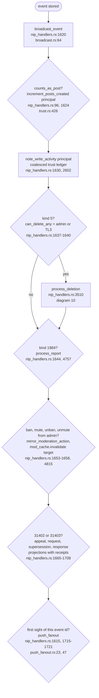

---

## 3. NIP-16 Event Treatment Detail

`event_treatment()` (`broadcast.rs:30-40`) classifies each kind. Kind 22242
(the NIP-42 AUTH response) is in the ephemeral range, but AUTH responses are
handled by `handle_auth`, not `handle_event`, so it never reaches here.
Kind 1059 (gift wrap) is `Regular`. Every stored treatment is written by
`save_event` (`storage.rs:111`): a regular event with
`INSERT ... ON CONFLICT (id) DO NOTHING` (`storage.rs:124-128`, `214-217`), a
replaceable one with an insert plus a prune of older versions in one D1 batch
(`REPLACEABLE_INSERT_SQL` `storage.rs:59`, `REPLACEABLE_PRUNE_SQL`
`storage.rs:71`, batch `storage.rs:165`), and an addressable one the same with
the `d` tag in the key (`ADDRESSABLE_INSERT_SQL` `storage.rs:38`,
`ADDRESSABLE_PRUNE_SQL` `storage.rs:51`, batch `storage.rs:205`). A kind-0
store also upserts the profile projection (`storage.rs:225-227`) and a kind-40
store records the channel creator (`storage.rs:232-246`).

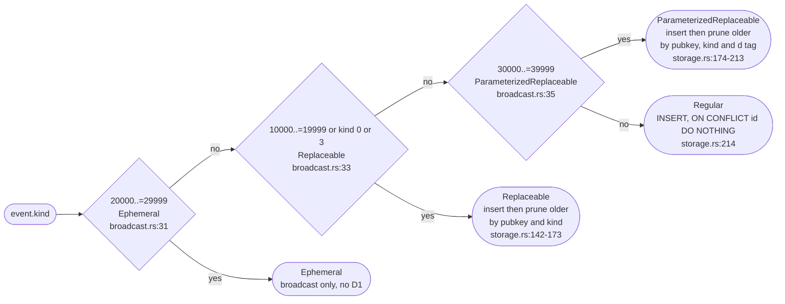

---

## 4. REQ Filter Handling and DM Scoping

`handle_req` (`nip_handlers.rs:1836-1995`) runs these stages:

1. **Rate limit** (`nip_handlers.rs:1853`).
2. **Subscription cap**: at most 20 per session (`MAX_SUBSCRIPTIONS`,
   `nip_handlers.rs:45`), decided by the pure `subscription_cap_reached`
   (`nip_handlers.rs:52-54`), called at `nip_handlers.rs:1862`. Since PR #91 a
   REQ that reuses an id the session already holds is a *replacement* and is
   never refused: a client replaying its subscriptions after NIP-42 AUTH
   re-sends every id it holds, and at a full session that replay used to be
   refused wholesale (`nip_handlers.rs:47-51`).
3. **Protected-kind read gate** (`nip42.rs:312`, called at
   `nip_handlers.rs:1895`): in `nip42` mode an unauthenticated session asking
   for a protected kind gets `CLOSED auth-required`.
4. **Gift-wrap filter rewrite** (`gate_kind_1059_filters_with`,
   `nip_handlers.rs:2230`, called at `1908`): a filter naming kind 1059 needs an
   authenticated session, and its `#p` is forced to the session pubkey, or set
   to the signer's read set (own key, registered recipient keys, epoch keys,
   `wrap_read_set` `nip_handlers.rs:2531`) when the client left `#p` unset.
5. **Subscription stored** and persisted to DO storage
   (`nip_handlers.rs:1926-1936`).
6. **Query** (`query_events`, `storage.rs:341`; SQL built by
   `build_filter_conditions`, `filter.rs:56`, with tag filters over the
   `event_tags` table, `filter.rs:154-159`, expired events skipped
   `storage.rs:416-422`).
7. **Per event**: wrap routing (`nip_handlers.rs:1954-1960`) then
   `authorize_event` (`nip_handlers.rs:2626`) decides Deliver, DeliverAs or
   Withhold (zone, calendar, kanban rules below).
8. **Read activity at EOSE**: `note_read_activity` (`nip_handlers.rs:1990-1992`,
   `2592`) coalesces the tally and flushes `increment_posts_read_by`,
   `update_last_active` and `check_promotion` (`nip_handlers.rs:2609-2613`,
   `trust.rs:443`, `459`, `202`), charged to the literal session pubkey.

**Open (O20):** the cap check at `nip_handlers.rs:1862` reads the session map,
releases the borrow and returns; the subscription is inserted at
`nip_handlers.rs:1929-1931`, after `wrap_read_set` (`1907`) and the filter
rewrite (`1908`), which await D1. Two REQs with different ids on one session
can both pass the check and both insert, so the cap can be exceeded by the
number of REQs in flight. The cap is a resource bound, not a security boundary.

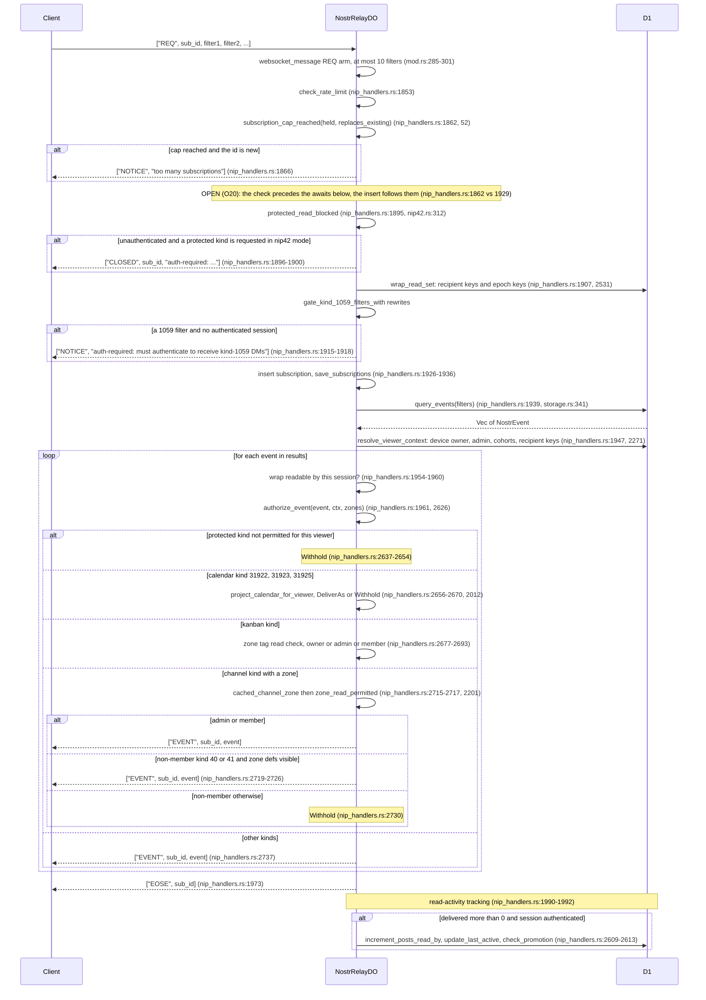

---

## 5. Broadcast Path: protected and zone-gated live fan-out

`broadcast_event` (`broadcast.rs:64-182`) applies the read gates again on the
live fan-out path, independently of the REQ path (diagram 4). It snapshots the
sessions (`broadcast.rs:84-99`), then for each: a protected-kind permission
check with the session's wrap read set (`broadcast.rs:113-139`), the kind-1059
recipient match against the session pubkey or its inbox and epoch keys
(`broadcast.rs:143-149`), and, for kinds 40, 42, calendar and kanban only
(`broadcast.rs:77-82`), the same `resolve_viewer_context` and `authorize_event`
the REQ path uses (`broadcast.rs:156-168`). Other kinds go to every session
whose filters match (`broadcast.rs:173-180`).

Both paths share `authorize_event`, so they cannot drift on zone rules; the
kind-1059 recipient rule is written twice (REQ rewrite and this match) on
purpose, as defence in depth.

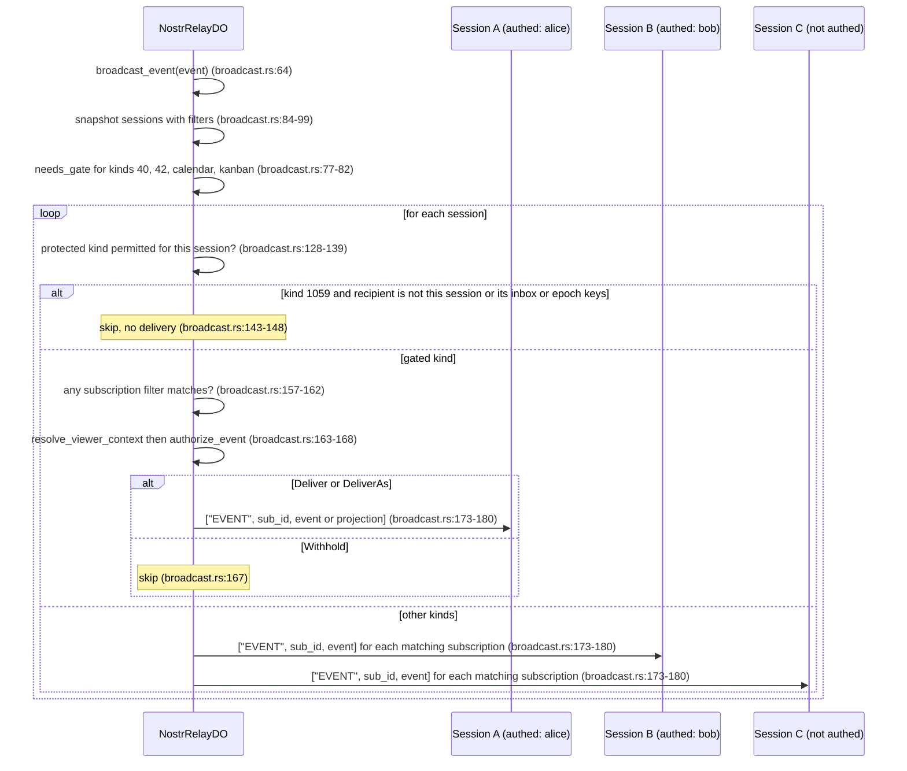

---

## 6. Trust Level Resolution and Admin Check Chain

Admin status is **two sources, in order** (`auth.rs:181-202`): the static
`ADMIN_PUBKEYS` var through `nostr_bbs_core::is_static_admin` (`auth.rs:184-191`),
then `whitelist.is_admin` (`auth.rs:193-200`). The relay no longer queries a
`members` table: that table lives in the auth-worker's database and the query
used to fail on every call (comment at `auth.rs:161-169`). Results are cached
for 30 s (`ADMIN_CACHE_TTL_SECS`, `auth.rs:46`, `AdminCache::is_admin`
`auth.rs:103-132`).

`check_promotion` (`trust.rs:202`) runs from the coalesced activity flush
(`nip_handlers.rs:2609-2613`), which both the write path
(`note_write_activity`, `nip_handlers.rs:1630`) and the EOSE read path
(`note_read_activity`, `nip_handlers.rs:1990-1992`) feed. There is no
per-pubkey demotion function any more: `check_demotion` was removed by decision
so that demotion cannot be called from a request handler (`trust.rs:405-420`,
ADR-2006). The pure policy is `decide_demotion` (`trust.rs:326`); the only code
that commits a demotion is the paged sweep `trust_sweep::sweep_inactive_demotions`
(`trust_sweep.rs:538`), run from the scheduled handler (`lib.rs:1633`).

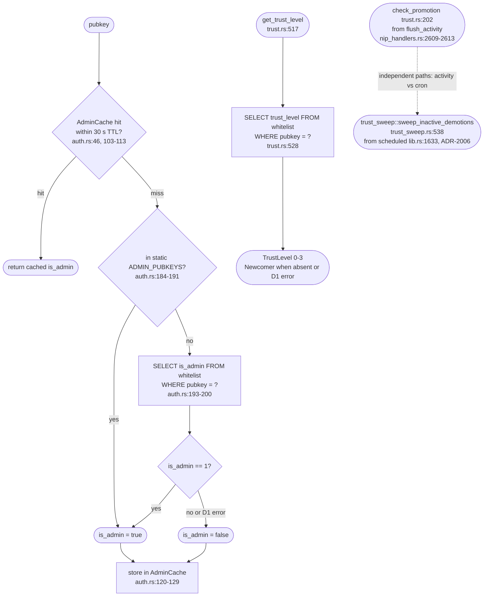

---

## 7. ModCache Ban/Mute Ingress Gate

`ModCache` (`relay_do/mod_cache.rs`) caches ban and mute state per pubkey for
60 s (`CACHE_TTL_SECS`, `mod_cache.rs:21`). It is consulted for every kind in
`is_ban_gated_kind` (`nip_handlers.rs:77`: content-bearing kinds including
reactions, deletions, reports, articles, channel create and metadata, calendar
events and RSVPs), for non-admin authors, once per sanction subject (the device
key and its owner, `nip_handlers.rs:1245-1254`). A D1 fault yields
`Block::Unknown`, which is treated as blocked (fail closed, `mod_cache.rs:65-74`)
and is never cached (`mod_cache.rs:85-88`). The mirror path
(`nip_handlers.rs:1653-1658`) fires when an admin sends kind 30910, 30911, 30915
or 30916 and invalidates the target's entry (`mod_cache.rs:59`).

**Invariant:** a ban applies to deletions too: kind 5 is in `is_ban_gated_kind`
(`nip_handlers.rs:77-79`), so a banned member cannot publish a kind-5 at all.

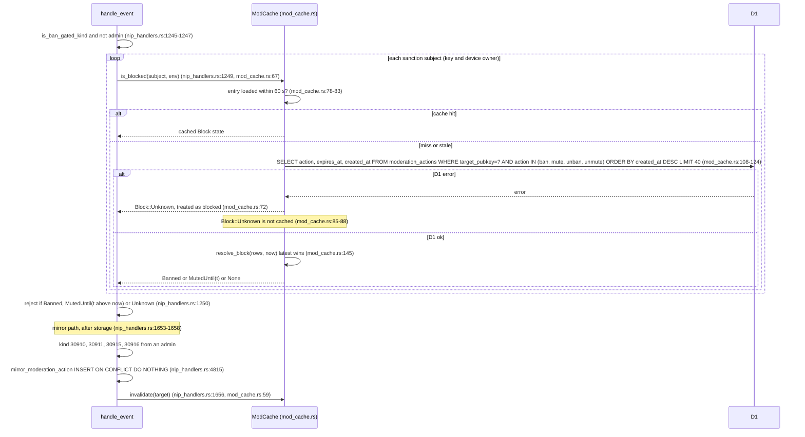

---

## 8. Session Hibernation Recovery

When the Workers runtime hibernates the Durable Object, the in-memory
`sessions`, `rate_limits` and `connection_counts` are lost but the WebSockets
and their tags survive. `recover_session` (`session.rs:75`) rebuilds a session
from the tags (`session.rs:76`) and DO storage.

**Drift (corrected):** the June map said the challenge is re-issued on recovery
so an AUTH in flight would fail. The code now persists the challenge as
`ws_chal:{sid}` at connect (`mod.rs:213`, `session.rs:308`) and *restores* it
(`session.rs:94-106`, `recovered_challenge` `session.rs:443`): a client that
connected but had not yet authed can still answer its original challenge. A new
challenge is minted and re-sent only when none was persisted
(`session.rs:103-106`, `189-194`). `recover_untracked_sessions`
(`session.rs:170-221`) does the same for every other surviving socket.

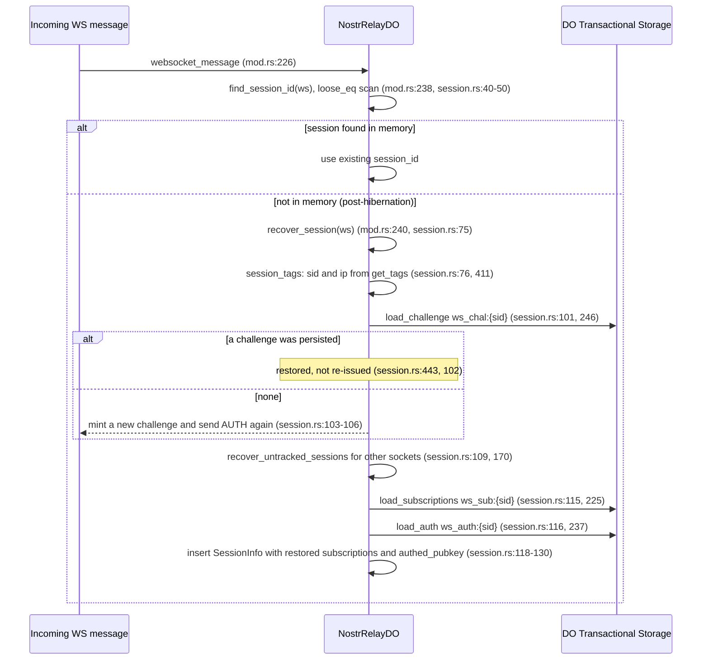

---

## 9. NIP-09 kind-5: the member deletion gate (PR #94)

Every forum client folds every `e` tag of a stored or broadcast kind-5 into its
tombstones, so the relay must vouch for each target before accepting the event
(section comment `nip_handlers.rs:2936-2955`; client side,
`client-onboarding-and-messaging.md` diagram 8). The gate runs at
`nip_handlers.rs:1320-1325`, only when the signer is **not** an admin
(`nip_handlers.rs:1259`) and below TL3 (`TrustLevel::Trusted`,
`nip_handlers.rs:1320`): admins and TL3 moderators skip it, so a moderator's
kind-5 is never refused here and the gate "can never block a moderator"
(`nip_handlers.rs:3345-3348`).

`member_deletion_gate` (`nip_handlers.rs:3349`) does this:

1. No `e` targets: accepted at once (`nip_handlers.rs:3351-3355`). An `a`-only
   kind-5 is scoped later by `a_ref_target` (diagram 10).
2. Any target that is not 64 lowercase hex: refused as unknown
   (`nip_handlers.rs:3356-3358`, `is_canonical_event_id` `nip_handlers.rs:2993`),
   because clients lowercase `e` values before folding while D1 compares
   exactly (`nip_handlers.rs:2988-2992`).
3. One D1 statement classifies every target (`DELETION_TARGETS_CLASSIFY_SQL`,
   `lib.rs:811-823`): the ids travel as one JSON value through `json_each`
   because a kind-5 may carry up to 2,000 `e` tags (`MAX_TAG_COUNT`,
   `nip_handlers.rs:42`) and D1 caps bound parameters near 100 (`lib.rs:793-797`).
   It returns a row only for a target that is **not** a stored event of the
   signer's (`lib.rs:823`), with the stored author and kind, the tags for kind
   1059 only, a `sealed` flag and a `tombstoned` flag (both read only when there
   is no row, `lib.rs:799-807`).
4. Each row is classified by `classify_member_target` (`nip_handlers.rs:3045`):
   a stored row by another author is `Foreign`; with no row, a `sealed` match is
   `SealedOriginal`, then `tombstoned` is `AlreadyDeleted`, else `Unknown`.
   **Invariant:** the sealed flag is read before the tombstone flag
   (`nip_handlers.rs:3054-3055`), so a claim written before the gate existed
   cannot reopen a sealed original (test `nip_handlers.rs:3236`).
5. `member_deletion_refusal` (`nip_handlers.rs:3075`) reports, in this order,
   foreign (`DELETE_OTHERS_REFUSAL`), sealed (`DELETE_SEALED_REFUSAL`), unknown
   (`DELETE_UNKNOWN_REFUSAL`). A foreign target is excused only when it is a
   gift wrap addressed to one of the signer's own recipient keys
   (`nip_handlers.rs:3079-3085`, keys fetched only then, `nip_handlers.rs:3379-3383`).
6. The refusal is for the whole event: the event is signed, the relay cannot
   strip a tag, and clients would still hide the id (`nip_handlers.rs:2944-2947`).
7. **Fails closed**: a missing D1 binding, a serialisation or bind error or a
   failed query answers `DELETE_LOOKUP_REFUSAL` (`nip_handlers.rs:3359-3376`).
   This is safe because the gate only runs for members.

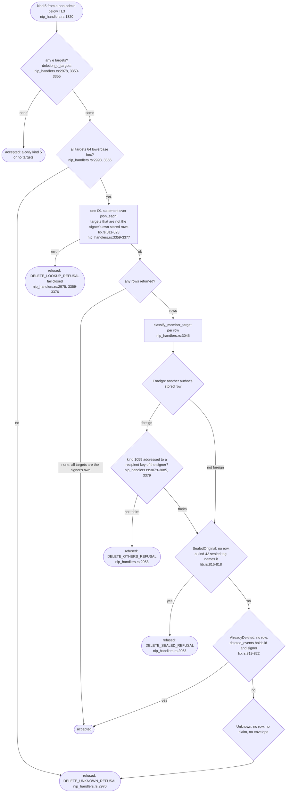

**Open (O12):** the gate's single query can carry up to 2,000 ids
(`nip_handlers.rs:42`, `lib.rs:793`). Every test of it runs against an in-memory
rusqlite database (`nip_handlers.rs:7698-7707`, `7756-7772`), not Cloudflare D1,
so the claim that one `json_each` statement fits D1's limits at 2,000 targets
has never been exercised against D1 itself.

**Open (O13):** the classifier accepts a no-row target on the strength of a
`deleted_events` row for `(id, signer)` (`lib.rs:819-822`, `nip_handlers.rs:3055`).
Rows of that shape include claims written before the gate existed (any id a
member once named, and the backfill from stored kind-5s, `lib.rs:915-925`), and
`process_deletion` still writes an `(id, signer)` row for any well-formed id
whether or not a row exists (`nip_handlers.rs:3533-3545`; a moderator's kind-5
is not gated). The gate's own comment says as much
(`nip_handlers.rs:3040-3044`). So a signer holding such a claim can re-name an
id that was never stored here and have the kind-5 accepted and broadcast. Clients
honour every deleter's tombstone for an ordinary post
(`crates/nostr-bbs-forum-client/src/stores/tombstones.rs:5-8`, `118-120`), so an
accepted kind-5 of this kind hides the named id on any client that holds or later
receives it. The relay's own `(id, author)` re-insert guard is not affected,
because the id commits to its author (`lib.rs:741-745`). After the gate, a
member can no longer create a new such claim: a no-row target they have no claim
for is refused (`nip_handlers.rs:3055-3056`); a moderator's kind-5 is not gated
and still writes one.

**Open (O14):** a kind-5 with no `e` or `a` target is accepted
(`nip_handlers.rs:3351-3355`, and `process_deletion` has nothing to act on), and
a kind-5 carrying an `expiration` tag passes `expiration_admission`
(`filter.rs:375-388`, no kind exemption) and is deleted by the NIP-40 retention
sweep once it expires (`cron.rs:411-440`). Neither is refused. Clients that
sync deletions with a `since` marker cannot recover a kind-5 the relay has since
expired (`deletion_sync.rs` module note on "expired NIP-40 kind-5s",
`crates/nostr-bbs-forum-client/src/stores/deletion_sync.rs:35-39`).

---

## 10. NIP-09 kind-5: `process_deletion` and tombstones (PRs #89, #94)

After the kind-5 itself is stored, `process_deletion`
(`nip_handlers.rs:3510`) removes its targets. `can_delete_any` is
`is_admin` or trust level at least TL3 (`nip_handlers.rs:1638-1639`). Without it
the SQL keeps the author constraint, "so a gate regression can never widen
deletion via this path alone" (`nip_handlers.rs:3505-3509`).

For each `e` target (`nip_handlers.rs:3526-3622`):

- a well-formed id gets an `(id, signer)` tombstone first
  (`DELETED_EVENT_INSERT_SQL`, `lib.rs:764-765`, run at `nip_handlers.rs:3538-3545`);
- then its address tombstone, if the stored row is replaceable: any author's for
  a moderator (`TombstoneTarget::Event`), the signer's own only otherwise
  (`TombstoneTarget::OwnEventAddress`) (`nip_handlers.rs:3549-3559`,
  `lib.rs:1519-1537`, `tombstone_before_delete` `lib.rs:1569`). The statements
  read the row's real author from `events` before the row goes
  (`lib.rs:870-883`), so a moderator's deletion is also recorded under the
  event's real author, which is what the ingest check matches on;
- then `DELETE FROM events` by id, scoped to the signer unless `can_delete_any`
  (`nip_handlers.rs:3560-3576`);
- then, for a member, the gift-wrap branch: a kind-1059 whose first `p` is one of
  the signer's recipient keys is tombstoned under the wrap's own ephemeral
  author and deleted (`nip_handlers.rs:3581-3621`).

After the `e` loop a **moderator's** deletion also removes the envelopes that
wrap a named sealed original (`nip_handlers.rs:3629-3631`,
`delete_sealed_envelopes` `nip_handlers.rs:3404`): each envelope is tombstoned
under its real author and deleted (`nip_handlers.rs:3450-3467`). Only rows with
an envelope's whole wire shape (`SEALED_ENVELOPES_FOR_SQL`, `lib.rs:838-850`)
written by an author who is **currently** an admin
(`admin_envelopes`, `nip_handlers.rs:3101`, check at `nip_handlers.rs:3437-3449`)
are removed. It is fail-open: a failed lookup leaves the envelope in place
(`nip_handlers.rs:3401-3403`).

For each `a` target (`nip_handlers.rs:3641-3686`) `a_ref_target`
(`nip_handlers.rs:2841`) decides whether it acts: only replaceable and
addressable kinds name an address; a regular kind is ignored entirely (one
`["a","1:<pubkey>:"]` would otherwise delete every kind-1 the author ever made,
`nip_handlers.rs:2836-2840`); the kind must be a non-negative integer
(`nip_handlers.rs:2847`); and without delete-any privilege the address must be
the signer's own (`nip_handlers.rs:2850`). An acting target upserts
`deleted_addresses` with `deleted_until = min(kind-5 created_at, now)`
(`DELETED_ADDRESS_UPSERT_SQL`, `lib.rs:769-773`, `nip_handlers.rs:3654-3662`) and
deletes versions up to the kind-5's own `created_at`
(`nip_handlers.rs:3664-3685`), so a newer version stays.

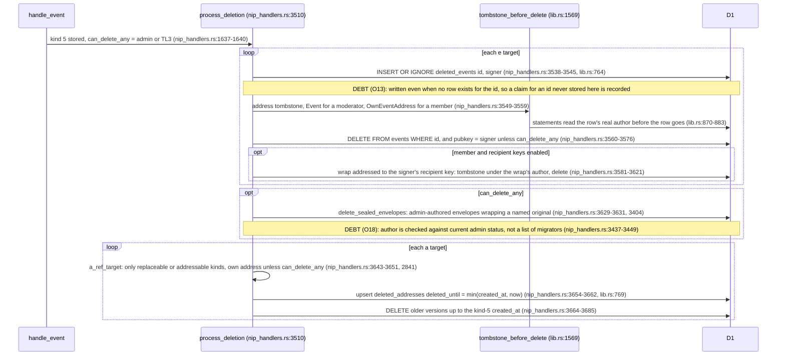

**Open (O15):** there is no admin route that removes a tombstone. The only code
that deletes from `deleted_events` or `deleted_addresses` is the whole-database
reset (`whitelist.rs:524-525`, `POST /api/admin/reset-db`, `lib.rs:362`), plus
the one-off re-key of plain-replaceable address rows (`lib.rs:953-964`). An
event deleted by mistake, by a report resolution or a user purge for example,
cannot be selectively re-admitted.

**Debt (O18):** `delete_sealed_envelopes` decides which envelopes a moderator
may remove by asking whether each envelope's author is an admin *now*
(`nip_handlers.rs:3437-3449`, `admin_envelopes` `nip_handlers.rs:3101`), not
whether the author is a recorded migrator. The code comment concedes the
corollary: an envelope whose migrator has since lost admin standing stays
(`nip_handlers.rs:3396-3399`), and an envelope published by any other current
admin, for any reason, is removable on the same authority.

**Open (O19):** nothing records the original authors of migrated (sealed) posts
as a deliberate list, so an author cannot delete their own migrated post: the
gate refuses a sealed original for a member by design (the author is inside the
envelope's ciphertext, `nip_handlers.rs:2952-2955`, and the code comment says
"the purge does not yet record original authors", `nip_handlers.rs:2961-2962`).
In practice the ADR-2017 purge does write `(original id, original author)`
tombstones as a side effect (`admin_events.rs:279-283`, `lib.rs:870-873`), but
`classify_member_target` reads the sealed flag first (`nip_handlers.rs:3054`),
so that record is never used to let an author delete.

---

## 11. Which deletion routes tombstone (PR #90)

A tombstone must be written before the row goes, because the statements read
the row's real author from `events` (`lib.rs:855-866`); an absent row records
nothing. Every route that removes events on a moderator's or admin's authority
calls `tombstone_before_delete` first and never in the same D1 batch as the
`DELETE`, so a failed tombstone cannot undo the deletion (`lib.rs:1562-1568`).
The tombstone is reported and never acted on: deletion proceeds if it fails.

| Route | Code | Tombstone target |
|-------|------|------------------|
| Member kind-5 and moderator kind-5 | `process_deletion` `nip_handlers.rs:3510` | signer claim, then row author and address (diagram 10) |
| Report resolved as `delete` (`POST /api/reports/resolve`) | `moderation.rs:335-367` | `Event(reported_event_id)`, then `DELETE FROM events WHERE id` (`moderation.rs:356-360`) |
| Admin purge of migrated plaintext (`POST /api/admin/events/delete`, kind 42 only) | `admin_events.rs:272-290`, route `lib.rs:377` | `RegularEvent(id)` then `DELETE ... AND kind = 42` |
| User purge (`POST /api/admin/user/delete`, `delete_events`) | `user_admin.rs:218-241`, route `lib.rs:440` | `Author(target)`, then `DELETE FROM events WHERE pubkey` |
| Cron retention and NIP-40 expiry | `cron.rs:284-470` | **none, deliberately** (`cron.rs:454-462`) |
| `reset-db` | `whitelist.rs:515-525` | clears every tombstone along with the events |

The cron sweep writes no tombstone because retention and expiry are storage
policy, not a decision that the content must never return, and a tombstone per
pruned row would grow without bound (`cron.rs:454-458`). Its own comment states
the residue: an expired event is refused at ingest (`filter.rs:375`), a kind-1
or kind-7 past its window fails the seven-day drift check, but kind 9024's
one-day window is shorter than the drift, so a copy one to seven days old can be
stored again and is pruned again by the next sweep (`cron.rs:459-462`).

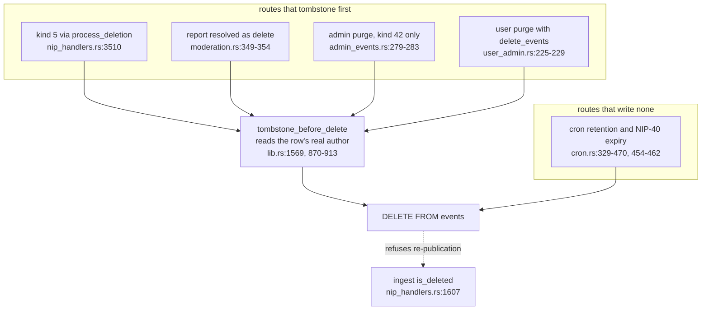

**Open (O16):** `GET /api/reports` lists `reported_pubkey` exactly as the
reporter claimed it. It is the `p` tag of the kind-1984 (`nip_handlers.rs:4765`),
stored as given (`moderation.rs:62-90`) and returned as `reportedPubkey`
(`moderation.rs:211`, `handle_list_reports` `moderation.rs:142`, query `moderation.rs:201`), with
no join to the stored event. The resolve route does read the stored row's real
author and kind before it deletes (`moderation.rs:335-346`), so the admin sees
the true author only after the decision.

**Open (O17):** the user purge tombstones and deletes events whose `pubkey` is
the purged key (`user_admin.rs:225-241`). It does not cover events signed by the
user's registered device keys (ADR-099, authored under their own key) and it
cannot cover gift wraps they received or sent, which are signed by throwaway
keys. Neither is touched.

---

## Findings

Status at `3c48e26`. Entries 1 to 13 keep their June numbering.

1. **RESOLVED (R13)** — ~~dual admin-table lookup, `members` then `whitelist`~~.
   The relay no longer queries `members`: admin is the static `ADMIN_PUBKEYS`
   set then `whitelist.is_admin` (`auth.rs:162-202`). The "admin in `members`
   but not in `whitelist`" inconsistency cannot arise in the relay. (Register
   O4.)
2. **RESOLVED (commit 42b1ded, ADR-102; reshaped by ADR-2006)** — demotion is
   wired: `trust_sweep::sweep_inactive_demotions` (`trust_sweep.rs:538`) from the
   scheduled handler (`lib.rs:1633`). `check_demotion` no longer exists
   (`trust.rs:405-420`).
3. **RESOLVED (commit 1e49c3e)** — reads are tallied and flushed through
   `note_read_activity` (`nip_handlers.rs:1990-1992`, `2592`, `2609-2613`).
4. **{severity: low, file: nip_handlers.rs:1246 and 1258, `admin_cache.is_admin()`
   is called twice for the same pubkey on a ban-gated kind. Both resolve to the
   same cached value within 30 s, so the second is a cache hit, duplicate}**
5. **{severity: medium, file: mod_cache.rs:65-74 vs storage.rs:437-453,
   `Block::Unknown` is fail-closed (treated as blocked) and `is_whitelisted` on
   D1 error returns `false`, which also rejects. Both refuse on a D1 fault, so
   the June "fail-open" wording was wrong: neither admits, ok}**
6. **{severity: low, file: nip_handlers.rs:3779 and 2338, the
   `DEVICE_KEYS_ENABLED` read is a Worker var read per call, the device-owner
   lookup is now memoised per pubkey, ok}**
7. **{severity: high, file: nip_handlers.rs:1329-1341, the NIP-29 TODO is still
   in the code (`nip_handlers.rs:1330-1332`): group metadata (39000-39002) is
   accepted from admin clients rather than relay-key-signed, doc-drift}**
   `nip11.rs:16` does not list NIP-29 in `SUPPORTED_NIPS`, so the gate guards
   kinds the relay does not advertise.
   (Register O2.)
8. **{severity: low, file: nip_handlers.rs:1354-1441, the governance gate is now
   several stages: agent registry with a kanban-request exemption
   (`1354-1366`), 31403 admission for admins and delegated reviewers
   (`1374-1388`), rationale for consequential cases (`1390-1409`), supersession
   authority (`1419-1429`), appeal shape (`1435-1441`). The June description of
   a single exempt-then-restrict split no longer fits, ok}**
9. **RESOLVED** — ~~`nostr-bbs-mesh` is a dead dependency of the relay~~. The
   relay now implements `MeshTransport` over its own socket in `mesh.rs`
   (`mesh.rs:1-52`). `is_mesh_peer` and `is_federated_kind_allowed`
   (`nip_handlers.rs:4702`, `4730`) remain inline env-var guards for the ingress
   decision.
10. **{severity: low, file: storage.rs:257-300, `upsert_profile` still returns
    silently on a parse failure or missing table, so a broken profiles
    projection is invisible, ok}**
11. **{severity: low, file: relay_do/filter.rs:755-763, the test
    `empty_ids_array_matches_all` is named and commented as matching all, while
    its assertion (`filter.rs:763`) proves an empty `ids` matches nothing. The
    code is right (NIP-01), the name and first comment line are wrong,
    doc-drift}**
12. **RESOLVED (R12)** — ~~kind-40 deletion locks a TL2 author out of their own
    channel~~. The creator is persisted in `channel_creators` when the kind-40 is
    stored (`storage.rs:232-246`, `lib.rs:735-739`) and `is_channel_creator`
    reads that table first, falling back to the kind-40 event
    (`nip_handlers.rs:3701-3724`). (Register O5.)
13. **RESOLVED** — ~~`project_action_response` parses the content twice~~.
    `response_action_and_reasoning` is a separate pure helper
    (`nip_handlers.rs:254`) and the projection path was rewritten around
    receipts (`nip_handlers.rs:4110`). Not re-audited line by line beyond that.
14. **Open (O12 to O20)** — the deletion and subscription-cap items above
    (diagrams 4, 9, 10, 11): D1 limit test (O12), tombstone legacy claims
    (O13), kind-5 shape (O14), no un-tombstone route (O15), report listing
    (O16), user purge scope (O17), envelope author check (O18), sealed-original
    authors (O19), cap race (O20). Written records: KF-21 (O12), KF-17 (O13),
    KF-20 (O14), KF-14 (O15), KF-15 (O16), KF-16 (O17), KF-18 (O18), KF-19
    (O19), KF-22 (O20) in `docs/security/known-findings.md`.
